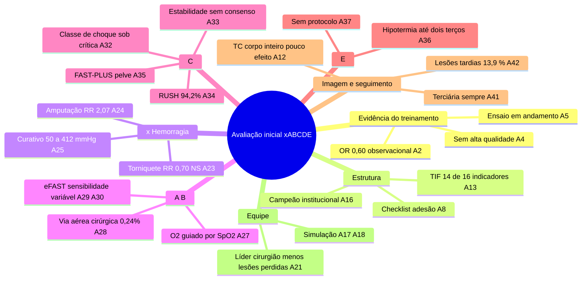

> RASCUNHO para revisão por 3 cirurgiões do trauma (tolerância: 5% erro leve / 0 crítico). Códigos [A#] remetem às afirmações com trecho literal da fonte. Trechos marcados **[DOUTRINA – confirmar na camada 2]** não vêm da revisão de artigos e devem ser conferidos no livro-texto (Mattox) antes da publicação.

# T001 — Mapa conceitual

