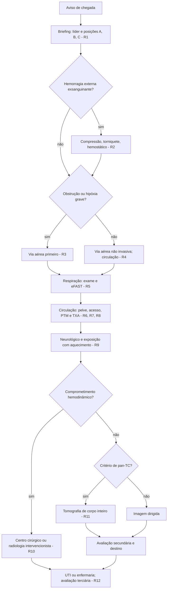

# T001 — Proposta de guia de atendimento: avaliação inicial do traumatizado na sala de trauma

> PROPOSTA para avaliação da diretoria e validação pelas equipes listadas em "Equipes para validação". Não é norma vigente nem diretriz validada.

Diretriz clínica, fluxo de atendimento e regulação, qualidade e segurança do paciente.

> RASCUNHO para revisão (versão 2.1, 19/11/2026). Guia do curso CUT, adaptável a cada serviço. Reescrita no padrão de `docs/diretriz_do_tema.md`. A força e a certeza de cada recomendação são propostas do grupo de elaboração e precisam ser conferidas pelos revisores contra a graduação publicada nas diretrizes de origem.

## Escopo e população

**Pergunta clínica.** Como organizar e conduzir os primeiros minutos do atendimento ao traumatizado na sala de trauma para identificar e tratar primeiro o que mata primeiro [D1], de forma padronizada e registrada.

**Incluídos.** Toda vítima de trauma admitida na sala de trauma (sala vermelha), adulta, por qualquer mecanismo, com ou sem aviso prévio do atendimento pré-hospitalar.

**Fora desta diretriz** (seguem a diretriz do próprio tema, a partir da avaliação primária):
- gestante: ver T119 (trauma na gestante);
- criança: ver T121 (trauma na criança);
- idoso e anticoagulado: ver T007;
- grande queimado: ver T076.

## Usuários e cenário

**Para quem.** Cirurgião do trauma (líder do atendimento), residentes de cirurgia e de emergência, enfermagem e técnicos da sala de trauma, anestesiologia quando acionada.

**Onde.** Sala de trauma de hospital terciário com cirurgião 24 horas, tomografia e agência transfusional no local. Em serviço sem algum desses recursos, ver "Adaptação local".

## Definições

- **Avaliação primária.** Sequência ABCDE; quando há hemorragia externa exsanguinante ou o paciente está em extremis, a circulação vem antes da via aérea (sequência CAB ou xABCDE) [D2, D3, G1].
- **Avaliação secundária.** História dirigida (alergias, medicamentos, passado médico e gestação, última refeição, ambiente e eventos) e exame físico completo, da cabeça aos pés [D20, D21].
- **Avaliação terciária.** Novo exame completo e revisão das imagens depois da ressuscitação e das cirurgias, para encontrar a lesão que passou [D30, D31].
- **Comprometimento hemodinâmico (critério do serviço).** Qualquer um: PAS ≤ 80 mmHg; PAS ≤ 100 mmHg com TCE moderado ou grave; vasopressor ou transfusão em curso para manter a pressão; frequência cardíaca maior ou igual à PAS (índice de choque ≥ 1) [P6]. O índice de choque serve para incluir, não para excluir instabilidade [P7], e o líder pode considerar o paciente instável mesmo sem critério objetivo [P8].
- **Limiar crítico de transfusão.** Três concentrados de hemácias em qualquer período de 1 hora nas primeiras 24 horas [D37].

## Recomendações

**Recomendação 1.** Definir o líder e as funções da equipe antes da chegada do paciente, com briefing do caso e plano B combinado.
Força: forte | Certeza: baixa
Origem: própria, a partir do livro-texto [D22, D42, D71] e da ficha do serviço [P18].
Justificativa: o trabalho simultâneo e coordenado encurta o tempo até as decisões que salvam vida; a evidência é sobretudo observacional e de opinião de especialistas.
Na prática: Ponto de protocolo: o cirurgião do trauma lidera [D22]; na ausência dele, o médico mais experiente presente, até o cirurgião assumir [P22]. Posições A (via aérea e neurológico), B (ventilação) e C (choque e hemorragia) [P18]. Passagem do caso pelo atendimento pré-hospitalar em até 1 minuto, com mecanismo, lesões, sinais e tratamento [D23, D24].

**Recomendação 2.** Na hemorragia externa exsanguinante, controlar o sangramento antes da via aérea.
Força: forte | Certeza: baixa
Origem: adotada do consenso WSES e Panamerican Trauma Society 2025 [G1]; consistente com a ficha do serviço [P19].
Justificativa: na metanálise do consenso, a sequência ABC se associou a maior mortalidade que a CAB [G2], mas toda a evidência é observacional e não permite concluir causalidade [G3].
Na prática: compressão direta [D6]; no membro, torniquete proximal à lesão, fora da articulação, com a hora anotada e limite de 90 minutos [D7, D59, D60]; nas regiões juncionais (pescoço, axila, virilha), compressão com agente hemostático [D8].
Divergência: as sequências clássicas começam pela via aérea; o consenso de 2025 é a fonte mais recente e foi a seguida (regra da fonte mais recente).

**Recomendação 3.** Manter a via aérea como primeira prioridade quando houver obstrução ou hipóxia grave.
Força: forte | Certeza: baixa
Origem: adotada de [G4].
Justificativa: a obstrução e a hipóxia grave matam em minutos, antes do sangramento.
Na prática: aspiração, cânula orofaríngea, manobras e oxigênio; plano de via aérea registrado na ficha (A, B ou C) [P20].

**Recomendação 4.** No paciente em choque hemorrágico sem obstrução e sem hipóxia grave, usar via aérea não invasiva enquanto a circulação é restaurada e adiar a intubação até a ressuscitação começar.
Força: condicional | Certeza: baixa
Origem: adotada de [G6]; justificativa fisiológica em [G7] e [D47].
Justificativa: a indução, a sedação e a ventilação com pressão positiva podem desfazer a vasoconstrição compensatória e levar ao colapso [G7, D47]. No trauma penetrante exsanguinante, o Glasgow baixo costuma refletir má perfusão cerebral, e não lesão neurológica [G5].
Na prática: cânula, bolsa-válvula-máscara e oxigênio [G6]. Glasgow ≤ 8 indica via aérea definitiva, com o exame neurológico feito antes da sedação [D11, D12]. Via aérea cirúrgica pronta quando a intubação falhar (T002).

**Recomendação 5.** Avaliar a respiração com exame dirigido e eFAST, sem tomar o eFAST negativo como exclusão de pneumotórax.
Força: forte | Certeza: moderada
Origem: própria, a partir de [A30] e do livro-texto.
Justificativa: o eFAST acelera o diagnóstico, mas a sensibilidade não é perfeita [A30].
Na prática: no paciente em extremis, drenagem torácica bilateral [D48]. Hemotórax no paciente instável: controle imediato da causa [P9].

**Recomendação 6.** Na hipotensão do trauma fechado, procurar e estabilizar a pelve, com cinta pélvica bem posicionada.
Força: forte | Certeza: baixa
Origem: própria, a partir do livro-texto [D55, D56] e do indicador da WSES [G11].
Justificativa: a cinta reduz o volume pélvico e o sangramento venoso; apertada demais na compressão lateral pode aumentar o sangramento [D55].
Na prática: cinta na altura dos trocânteres; na falta, lençol e haste [D56].

**Recomendação 7.** Sem veia periférica em até poucas tentativas, usar acesso intraósseo.
Força: forte | Certeza: baixa
Origem: própria, a partir do livro-texto [D15, D46].
Justificativa: o acesso intraósseo é rápido e permite infundir hemocomponentes.
Na prática: úmero proximal como primeira escolha, salvo contraindicação; tíbia como alternativa [D15, D46].

**Recomendação 8.** Acionar o protocolo de transfusão maciça por critério objetivo ou por avaliação do líder, e administrar ácido tranexâmico até 3 horas da lesão no paciente com sangramento significativo.
Força: forte | Certeza: moderada
Origem: transfusão adaptada do protocolo do serviço [P16, P17] e do livro-texto [D33, D34, D35, D36, D37]; ácido tranexâmico adotado do protocolo AAST/ACS-COT de ressuscitação de controle de danos [G8].
Justificativa: a hipotensão prediz a necessidade de transfusão maciça [G9]; os escores têm bom valor preditivo negativo e valor preditivo positivo fraco, por isso o julgamento do líder também aciona [D34, P8].
Na prática: Ponto de protocolo: acionar se escore ABC ≥ 2 (FAST positivo, mecanismo penetrante, FC > 120, PAS < 90; um ponto cada) [D33, P16], comprometimento hemodinâmico pela definição do serviço [P6], limiar crítico de transfusão [D37] ou decisão do líder [P8]. Avisar o banco de sangue de imediato [D35]. Sequência de liberação conforme o protocolo do serviço [P17].
Divergência: o livro-texto usa índice de choque de 0,9 como corte de risco [D38]; o serviço usa 1,0 como critério de acionamento [P6]. Vale o critério do serviço, por ser o definido localmente; o corte de 0,9 fica como alerta.

**Recomendação 9.** Prevenir e tratar a hipotermia desde a chegada: despir, aquecer o ambiente, os fluidos e o paciente, e medir a temperatura.
Força: forte | Certeza: baixa
Origem: própria, a partir de [D18, D19, A36] e do indicador da WSES [G11].
Justificativa: a hipotermia piora a coagulopatia e se associa a maior mortalidade [A36].
Na prática: manta de ar forçado e aquecedor de fluidos [D19]; temperatura registrada na admissão.

**Recomendação 10.** Paciente instável não vai à tomografia para diagnóstico: vai ao controle do sangramento.
Força: forte | Certeza: baixa
Origem: adotada do protocolo de imagem do serviço, em validação [P9, P10].
Justificativa: o tempo na tomografia atrasa o controle da causa do choque.
Na prática: centro cirúrgico, ou radiologia intervencionista quando o sangramento for de controle endovascular, como na fratura pélvica grave [D40].

**Recomendação 11.** No paciente estável ou que respondeu à reposição, indicar tomografia de corpo inteiro por critério de mecanismo, clínico ou neurológico, sem esperar creatinina nem jejum.
Força: condicional | Certeza: baixa
Origem: adotada do protocolo de imagem do serviço [P2, P3, P4, P5, P12]; pan-TC não é sinônimo de qualquer trauma [P15].
Justificativa: a pan-TC encontra lesões ocultas no politraumatizado de alto risco, mas tem custo e radiação; sem critério, a imagem é dirigida pelo exame e por regras clínicas [P11].
Na prática: meta de porta-tomografia de 30 minutos, ainda pendente no protocolo do serviço [P14].

**Recomendação 12.** Fazer a avaliação terciária em todo paciente internado e tratar a hipotensão após a ressuscitação como sangramento até prova em contrário.
Força: forte | Certeza: baixa
Origem: própria, a partir do livro-texto [D30, D31, D32] e de [A42].
Justificativa: as lesões não identificadas são a complicação mais comum do atendimento inicial [A42].
Na prática: reexame completo e revisão das imagens em até 24 horas [D30].

## Fluxograma

## Quadro-resumo

| Nº | Recomendação | Força | Certeza |
|---|---|---|---|
| 1 | Líder e funções definidos antes da chegada | Forte | Baixa |
| 2 | Hemorragia externa antes da via aérea | Forte | Baixa |
| 3 | Via aérea primeiro se obstrução ou hipóxia grave | Forte | Baixa |
| 4 | No choque, via aérea não invasiva até ressuscitar | Condicional | Baixa |
| 5 | eFAST negativo não exclui pneumotórax | Forte | Moderada |
| 6 | Cinta pélvica na hipotensão do trauma fechado | Forte | Baixa |
| 7 | Intraósseo sem veia periférica | Forte | Baixa |
| 8 | Transfusão maciça por critério ou líder; TXA até 3 h | Forte | Moderada |
| 9 | Prevenir e tratar hipotermia desde a chegada | Forte | Baixa |
| 10 | Instável não vai à tomografia | Forte | Baixa |
| 11 | Pan-TC por critério no estável | Condicional | Baixa |
| 12 | Avaliação terciária em todo internado | Forte | Baixa |

## Fluxo de atendimento e regulação

A linha de cuidado vai do aviso de chegada à avaliação terciária. Tempo-alvo sem fonte fica para o serviço definir.

| Etapa | Gatilho de entrada | O que acontece | Responsável | Tempo-alvo | Registro |
|---|---|---|---|---|---|
| 1. Aviso e preparo | Aviso da regulação ou do atendimento pré-hospitalar | Acionar a equipe, definir líder e posições A, B e C, preparar sala, aquecimento e hemocomponentes conforme o caso (R1) | Líder do atendimento; enfermagem da sala | Equipe na sala antes da chegada; [meta a definir pelo serviço] | Ficha da sala de trauma [P18] |
| 2. Chegada e passagem do caso | Entrada do paciente na sala | Passagem estruturada pelo modelo MIST: mecanismo, lesões suspeitas, sinais e sintomas, tratamentos [D23] | Equipe do pré-hospitalar para o líder | 45 segundos a 1 minuto [D24] | Ficha |
| 3. Avaliação primária e ressuscitação | Fim da passagem | Hemorragia externa, via aérea, respiração, circulação, neurológico e exposição (R2 a R9); comunicação em alça fechada [D70] | Líder; posições A, B e C | [meta a definir pelo serviço] | Ficha [P18 a P20] |
| 4. Decisão de destino | Fim da avaliação primária | Instável: centro cirúrgico ou radiologia intervencionista (R10). Estável: imagem por critério (R11) | Líder | Porta-tomografia de 30 minutos, meta ainda pendente no serviço [P14] | Ficha; sistema da radiologia |
| 5. Transferência interna | Destino definido | Pausa de segurança antes de sair da sala [P21]; transporte monitorado; passagem do caso à equipe que recebe | Líder; enfermagem; equipe que recebe | [meta a definir pelo serviço] | Ficha (hora do time out) [P21] |
| 6. Avaliação secundária e terciária | Paciente estabilizado; internação | Avaliação secundária completa [D20]; avaliação terciária e revisão das imagens no internado (R12) | Equipe de cirurgia responsável pelo leito | Avaliação terciária em até 24 horas [D30] | Prontuário |

### Regulação

- **Entrada.** O caso chega pela central de regulação de urgência, pelo atendimento pré-hospitalar, por demanda espontânea ou por transferência de outro hospital. O aviso prévio vai direto à sala de trauma por um canal único, definido na "Adaptação local".
- **Aceite de transferência.** Contato médico a médico, com o líder ou o cirurgião responsável; o caso é aceito pelo recurso que o paciente precisa, não pelo leito vago. Registrar quem aceitou e a hora.
- **Transferência para fora.** Quando falta recurso no serviço (tomografia, radiologia intervencionista, especialidade), transferir depois da estabilização possível, com contato médico a médico, relatório escrito, imagens e transporte com o nível de suporte que o paciente exige. Normas de regulação e de transporte inter-hospitalar: ver a pasta `LegislacaoBR` e conferir a versão vigente.
- **Regulação interna de leitos.** A vaga de UTI, de centro cirúrgico e de enfermaria é pedida ao núcleo interno de regulação (ou equivalente) logo na decisão de destino, não no fim do atendimento.

### Passagem de cuidado

Toda passagem entre equipes (pré-hospitalar para a sala, sala para o centro cirúrgico, a UTI ou a enfermaria, troca de plantão) segue um modelo estruturado. Na chegada, o MIST [D23]. Nas demais, o curso sugere identificação, situação, lesões encontradas, o que foi feito, o que está pendente e o plano, num modelo único definido pelo serviço (sugestão do curso, sem fonte de comparação entre modelos neste tema).

## Matriz de responsabilidades

Sugestão do curso, para o serviço confirmar na implantação. R = executa; A = responde pelo resultado (um por linha); C = consultado; I = informado.

| Atividade | Líder (cirurgião do trauma) | Emergencista ou residente | Anestesiologia | Enfermagem da sala | Radiologia | Agência transfusional | Regulação e núcleo interno de regulação | Coordenação do serviço | Comissão de qualidade e segurança |
|---|---|---|---|---|---|---|---|---|---|
| Receber o aviso e acionar a equipe | A | I | I | R | — | I (se choque) | R | — | — |
| Briefing e distribuição das posições | A, R | R | C | R | — | — | — | — | — |
| Passagem do caso na chegada | A | I | I | R (registro) | — | — | — | — | — |
| Avaliação primária e ressuscitação | A | R | R (via aérea, se acionada) | R | — | — | — | — | — |
| Acionar o protocolo de transfusão maciça | A, R | C | C | R (contato com a agência) | — | R | — | — | — |
| Decisão de destino e de imagem | A, R | C | C | I | C | — | I | — | — |
| Pedir a vaga e regular o leito | A | R | — | R | — | — | R | I | — |
| Pausa de segurança e transporte | A | R | R | R | — | — | — | — | — |
| Avaliação terciária | A (equipe do leito) | R | — | I | C | — | — | — | — |
| Registro na ficha | A | R | R | R | — | — | — | — | — |
| Coleta mensal dos indicadores | — | — | — | R | — | — | — | A | I |
| Análise dos indicadores e plano de melhoria | C | — | — | C | — | — | — | R | A |
| Revisão de casos (morbimortalidade) | R | R | C | C | C | C | — | A | I |

## Indicadores de qualidade

Sempre como totais do mês, sem nenhum dado que identifique paciente. Metas com fonte quando houver; as demais são propostas do curso para o serviço confirmar. Os indicadores de processo da cinta pélvica e do reaquecimento constam do consenso de indicadores da WSES [G10, G11].

| Indicador | Tipo | Numerador | Denominador | Meta | Fonte do dado | Periodicidade | Coleta | Análise |
|---|---|---|---|---|---|---|---|---|
| Líder definido antes da chegada | Processo | Atendimentos com líder registrado antes da chegada | Atendimentos com aviso prévio | ≥ 90% (proposta) | Ficha da sala de trauma [P18] | Mensal | Enfermagem da sala | Coordenação do serviço |
| Passagem estruturada do pré-hospitalar | Processo | Atendimentos com passagem MIST registrada | Atendimentos trazidos pelo pré-hospitalar | ≥ 90% (proposta) | Ficha [D23] | Mensal | Enfermagem da sala | Coordenação do serviço |
| Via aérea avaliada e registrada | Processo | Admissões com via aérea avaliada e registrada | Admissões de trauma na sala | ≥ 95% (proposta) | Ficha [A14] | Mensal | Enfermagem da sala | Coordenação do serviço |
| Temperatura na admissão | Processo | Admissões com temperatura medida | Admissões de trauma na sala | ≥ 90% (proposta) | Ficha | Mensal | Enfermagem da sala | Coordenação do serviço |
| Cinta pélvica na fratura instável | Processo | Fraturas pélvicas instáveis com cinta | Fraturas pélvicas instáveis | ≥ 90% (proposta) | Registro de trauma [G11] | Mensal | Registro de trauma | Comissão de qualidade |
| Porta-tomografia | Processo | Pacientes estáveis com pan-TC em até 30 minutos | Pacientes estáveis com pan-TC | ≥ 80% (proposta; meta de 30 minutos pendente no serviço [P14]) | Sistema da radiologia | Mensal | Radiologia | Comissão de qualidade |
| Pausa de segurança antes de sair da sala | Processo | Transferências com time out registrado | Transferências da sala para centro cirúrgico, UTI ou tomografia | ≥ 90% (proposta) | Ficha [P21] | Mensal | Enfermagem da sala | Comissão de qualidade |
| Avaliação terciária registrada | Processo | Internados com avaliação terciária em até 24 horas | Internados por trauma | ≥ 90% (proposta) | Prontuário [D30] | Mensal | Equipe de cirurgia | Coordenação do serviço |
| Lesão com diagnóstico tardio | Resultado | Lesões diagnosticadas depois da avaliação secundária | Internados por trauma | Sem meta: acompanhar a tendência [A42] | Revisão de casos | Trimestral | Coordenação do serviço | Reunião de morbimortalidade |
| Mortalidade dos traumatizados graves | Resultado | Óbitos hospitalares | Admissões de trauma grave (critério do serviço) | Sem meta: acompanhar ajustada pela gravidade | Registro de trauma | Trimestral | Registro de trauma | Comissão de qualidade |

## Monitoramento e melhoria

- **Coleta.** Até o 5º dia útil de cada mês, os totais do mês anterior entram na planilha de totais do serviço (só numerador e denominador, sem dado de paciente), pelo responsável da coluna "Coleta".
- **Análise.** Mensal, na reunião da coordenação do serviço, com o gráfico de cada indicador mês a mês e a meta; com 12 meses ou mais, gráfico de controle. O painel de desempenho do curso mostra o mesmo formato.
- **Gatilhos de ação.** Indicador abaixo da meta por 3 meses seguidos vai à comissão de qualidade, com análise de causa e um ciclo de melhoria (planejar, fazer, estudar, agir) com responsável e prazo. Queda brusca em um mês é conferida primeiro como erro de registro.
- **Revisão de casos.** Vão sempre à reunião de morbimortalidade: óbito na sala de trauma ou nas primeiras 24 horas, lesão com diagnóstico tardio, paciente instável levado à tomografia, atraso no acionamento da transfusão maciça e todo evento adverso grave.
- **Auditoria.** A cada trimestre, amostra de fichas conferida contra o prontuário (preenchimento e coerência dos horários).
- **Relatório à diretoria.** Semestral: indicadores, ações tomadas e o que ainda depende de recurso.

## Segurança do paciente

| Risco | Como acontece | Barreira prevista neste guia | Protocolo básico de segurança relacionado | Notificar ao núcleo de segurança do paciente |
|---|---|---|---|---|
| Troca de paciente desconhecido | Vítima sem documento, vários atendimentos ao mesmo tempo | Identificação provisória padronizada na chegada, antes de qualquer coleta ou hemocomponente (Adaptação local) | Identificação do paciente | Troca ou quase troca de identificação |
| Informação perdida na passagem | Passagem longa, sem estrutura, ou feita durante procedimentos | Passagem MIST de até 1 minuto [D23, D24]; comunicação em alça fechada [D70]; passagem estruturada entre equipes | Comunicação efetiva | Evento com dano ligado à passagem |
| Erro de hemocomponente | Urgência, liberação em sequência, paciente sem tipagem | Acionamento por critério e aviso precoce à agência [D35, P16, P17]; dupla checagem à beira do leito | Segurança na administração de medicamentos e hemocomponentes | Reação transfusional; troca de bolsa |
| Lesão não identificada | Foco na lesão mais evidente, paciente sedado | Avaliação secundária completa e avaliação terciária (R12) [A42] | — | Lesão com diagnóstico tardio e dano |
| Deterioração fora da sala | Paciente instável levado à tomografia; transporte sem monitorização | Instável não vai à tomografia (R10); pausa de segurança antes de sair [P21] | Cirurgia segura (pausa e conferência) | Parada ou deterioração no transporte |
| Hipotermia | Exposição prolongada, fluidos frios | Prevenção desde a chegada e temperatura registrada (R9) | — | — |
| Torniquete esquecido | Hora não anotada, troca de equipe | Hora do torniquete registrada e limite de 90 minutos (R2) [D7, D59, D60] | Comunicação efetiva | Isquemia por torniquete |
| Medicamento em paciente sem história | Alergia desconhecida, anticoagulante não informado | Perguntar e registrar alergias e medicamentos na avaliação secundária [D20]; exceções do anticoagulado (T007) | Segurança na prescrição e administração de medicamentos | Reação adversa grave |

Evento adverso grave e óbito evitável: notificação e análise conforme a norma de segurança do paciente vigente (ver a pasta `LegislacaoBR` e conferir a versão vigente). A notificação serve para aprender, não para punir.

## Adaptação local

Campos para o serviço preencher antes de adotar a diretriz:
- [ ] Quem lidera quando o cirurgião do trauma não está na sala, e por qual telefone é chamado:
- [ ] Protocolo de transfusão maciça vigente (anexar), hemocomponentes disponíveis e tempo até a sala:
- [ ] Ácido tranexâmico: onde fica e quem prepara:
- [ ] Tomografia 24 horas: sim ou não; tempo médio porta-tomografia:
- [ ] Radiologia intervencionista: horário disponível e como acionar:
- [ ] Sala híbrida: sim ou não:
- [ ] Serviço de referência para transferência e regulação:
- [ ] Critérios de admissão na UTI combinados com a equipe da UTI:
- [ ] Canal único do aviso prévio (telefone ou rádio) e quem o atende na sala:
- [ ] Modelo de identificação provisória do paciente desconhecido:
- [ ] Contato do núcleo interno de regulação (ou equivalente) para vaga de UTI, centro cirúrgico e enfermaria:
- [ ] Tempos-alvo do serviço para as etapas sem meta definida neste guia:
- [ ] Responsáveis nominais pela coleta e pela análise de cada indicador:
- [ ] Número mínimo de casos no período para um indicador contar como critério de saída de nível (sugestão do curso: 20):
- [ ] Nível de maturidade atual do serviço neste guia (0 a 5) e data da avaliação:

Sem tomografia no local: imagem dirigida e transferência regulada depois da estabilização. Sem radiologia intervencionista: fratura pélvica instável com choque vai ao tamponamento pré-peritoneal (ver o tema de pelve e fratura exposta).

## Implantação

A implantação segue o modelo de maturidade do curso (`docs/maturidade_implantacao.md`): seis níveis, do serviço sem protocolo (nível 0) ao serviço com tudo implantado e desempenho no percentil 90 (P90) da referência internacional (nível 5). Só se passa ao nível seguinte quando os critérios de saída do nível atual se mantêm pelo período pedido, com o número mínimo de casos definido na "Adaptação local". As metas marcadas como proposta são do curso, para o serviço confirmar.

### Níveis de maturidade deste guia

| Nível | Objetivo | Marcadores e indicadores do T001 | Critério para passar ao nível seguinte |
|---|---|---|---|
| 0. Sem protocolo | Saber de onde parte | Diagnóstico da sala de trauma: ficha existente, cirurgião 24 h, tomografia 24 h, radiologia intervencionista, protocolo de transfusão maciça, número de atendimentos por mês; responsável pelo guia nomeado | Proposta entregue à diretoria e equipes da validação convidadas |
| 1. Formalizado | Regra escrita, aceita e conhecida | Pareceres das equipes; "Adaptação local" preenchida; ficha alinhada ao guia [P18 a P21]; percentual da equipe treinada; linha de base dos 10 indicadores | Guia aprovado com data e instância; ≥ 80% da equipe fixa treinada (proposta); 3 meses de linha de base |
| 2. Em uso | Fazer o que está escrito, sempre, e registrar | Líder definido antes da chegada; passagem MIST; via aérea registrada; temperatura na admissão; cinta pélvica; time out antes de sair da sala | Campos-chave da ficha preenchidos em ≥ 90% e esses 6 indicadores na meta por 3 meses seguidos |
| 3. Gerenciado | Corrigir desvios de forma sistemática | Os 10 indicadores no painel; ciclos de melhoria abertos e concluídos; concordância da auditoria de fichas; eventos notificados; casos revistos na morbimortalidade | Todos os indicadores de processo na meta por 6 meses; todo gatilho com plano; auditoria com concordância ≥ 90% (proposta) |
| 4. Comparado | Saber onde o serviço está em relação aos melhores | Participação em registro de trauma com ajuste de risco; mortalidade ajustada pela gravidade; lesão com diagnóstico tardio; porta-tomografia comparada | 12 meses de dados ajustados; indicadores comparáveis na mediana da referência ou acima |
| 5. Excelência | Ser referência e manter | Percentil do serviço em cada indicador comparável; tempo sustentado no P90; verificação externa; projetos do banco de pesquisa em andamento | Manter processo e resultado ajustado no P90 por 12 meses; queda por 3 meses volta o indicador ao nível 4 |

**Referência para o P90.** [P90 sem referência publicada carregada neste tema: pedido à coordenação, o relatório de benchmarking com ajuste de risco do registro de trauma de referência e, se houver, valores de referência para os indicadores da WSES [G10, G11]. Até lá, usar a meta interna sustentada por 12 meses.]

### Execução passo a passo (do nível 0 ao nível 2)

| Passo | O que entregar | Quem responde | Prazo sugerido | Nível ao terminar |
|---|---|---|---|---|
| 1. Diagnóstico | Diagnóstico da sala de trauma e responsável nomeado | Coordenação do serviço | Semana 1 | 0 |
| 2. Apresentação | Esta proposta entregue à diretoria, com o quadro-resumo, os indicadores e este plano | Coordenação do serviço | Semana 2 | 0 → 1 |
| 3. Validação pelas equipes | Parecer de cada equipe da tabela "Equipes para validação" | Cirurgia de urgência e trauma (conduz) | Semanas 2 a 6 | 1 |
| 4. Adaptação local | Campos da "Adaptação local" preenchidos e aprovados; ficha revisada | Coordenação do serviço | Semanas 4 a 8 | 1 |
| 5. Linha de base | Indicadores medidos com a ficha nova, antes do treinamento | Comissão de qualidade | 3 meses (junto dos passos 3 e 4) | 1 |
| 6. Treinamento | Aula, simulação no local com a equipe da sala [A44] e material de bolso | Coordenação do serviço e enfermagem | Antes do piloto | 1 |
| 7. Piloto | Guia em uso, com acompanhamento mensal | Líderes do atendimento | 3 meses | 1 → 2 |
| 8. Rotina | Ajustes do piloto incorporados; nova versão para aprovação | Diretoria e comissão de qualidade | Fim do piloto | 2 |

Do nível 2 em diante, o plano de cada passagem de nível é feito pela comissão de qualidade com os critérios da tabela acima.

- **Materiais de apoio.** Ficha da sala de trauma [P18], cartaz com o quadro-resumo e o fluxograma, checklist do tema (peça "checklist") e cartão de bolso.
- **O que ajuda a implantar.** Um responsável institucional pelo guia, adaptação ao contexto do serviço e integração à rotina e à ficha [A16].
- **Barreiras previsíveis.** Rodízio de equipes e residentes, falta de tempo para registrar, ficha diferente da prática. Resposta: treinamento a cada entrada de residentes e ficha revisada junto com o guia.

## Exceções

- **Gestante:** deslocamento uterino manual para a esquerda e avaliação obstétrica precoce (T119).
- **Anticoagulado ou antiagregado:** reversão precoce, conforme o fármaco (T007 e T114).
- **Recusa de hemocomponente** por adulto capaz: registrar a recusa e seguir com as alternativas disponíveis (T087).
- **TCE grave associado:** meta de PAS mais alta, conforme a diretriz do TCE (T040).
- **Parada cardíaca traumática:** toracotomia de reanimação conforme indicação (T019).

## Base legal e ética

- Paciente inconsciente sem responsável: o atendimento de urgência não espera consentimento; registrar a situação no prontuário (Código de Ética Médica, Resolução CFM 2.217/2018; prontuário, Resolução CFM 1.638/2002).
- Recusa de transfusão por adulto capaz: respeitar a decisão, documentar e oferecer as alternativas (Resolução CFM 2.232/2019; STF, Temas 952 e 1069, 2024). Conferir a vigência na pasta `LegislacaoBR`.
- Suspeita de violência: notificação compulsória e comunicação conforme a lei (T086).

## Método e fontes

- **Busca.** A busca do tema em `BUSCAS_PUBMED_150_temas.txt`, com filtro de diretriz dos últimos 10 anos, e as fontes já guardadas no tema.
- **Diretrizes usadas.** Consenso WSES e Panamerican Trauma Society 2025 [G1 a G7]; protocolo AAST/ACS-COT de ressuscitação de controle de danos [G8, G9]; consenso de indicadores de qualidade da WSES [G10, G11]. Protocolos do serviço: imagem no politrauma (versão preliminar, em validação) [P1 a P15], transfusão maciça [P16, P17] e ficha da sala de trauma [P18 a P22].
- **Livros-texto.** Mattox, Trauma, 9ª ed. (2021), e manual do European Trauma Course (códigos D).
- **Graduação.** Força e certeza propostas pelo grupo, pelo GRADE, a partir do desenho dos estudos citados em cada fonte; precisam ser conferidas contra a graduação publicada em cada diretriz de origem.
- **Conflito entre fontes.** Vale a mais recente, pela data de publicação; no mesmo ano, diretriz, revisão sistemática, ensaio, livro.

## Equipes para validação

A cirurgia de urgência e trauma conduz a validação. As demais equipes validam as recomendações da sua área.

| Equipe | Por que participa | O que valida | Situação |
|---|---|---|---|
| Cirurgia de urgência e trauma | Lidera o atendimento e o fluxo inteiro (R1 a R12) | Texto inteiro | A convidar |
| Medicina de emergência | Divide a sala de trauma e o atendimento inicial | R1 a R9, fluxograma | A convidar |
| Anestesiologia | Via aérea e indução no choque | R3, R4 | A convidar |
| Enfermagem da sala de trauma | Posições da equipe, ficha, aquecimento, acesso | R1, R7, R9, indicadores | A convidar |
| Hemoterapia e agência transfusional | Protocolo de transfusão maciça e ácido tranexâmico | R8 | A convidar |
| Radiologia e radiologia intervencionista | Pan-TC, porta-tomografia, embolização | R10, R11 | A convidar |
| Terapia intensiva | Critérios de admissão na UTI e avaliação terciária | R12, destino | A convidar |
| Ortopedia | Cinta pélvica e fratura pélvica instável | R6 | A convidar |
| Neurocirurgia | Paciente com TCE grave associado | R4 (Glasgow e via aérea), exceções | A convidar |
| Atendimento pré-hospitalar e regulação | Aviso prévio e passagem do caso | R1 | A convidar |
| Comissão de qualidade e núcleo de segurança do paciente | Indicadores, monitoramento, riscos e notificação | Indicadores de qualidade, Monitoramento e melhoria, Segurança do paciente | A convidar |
| Núcleo interno de regulação e gestão de leitos | Vaga de UTI, centro cirúrgico e enfermaria; transferências | Fluxo de atendimento e regulação, Matriz de responsabilidades | A convidar |
| Diretoria clínica e técnica | Aprovação da proposta e dos recursos da implantação | Implantação, Adaptação local | A convidar |

## Grupo de elaboração e conflitos de interesse

- **Redação do rascunho:** agente produtor do CUT, sob supervisão da coordenação.
- **Coordenação:** [nome do coordenador], [instituição]. Conflitos de interesse: [declarar].
- **Revisores:** [nomes, após a autorização de cada um pelo termo de autorização e declaração de conflitos de interesse]. Conflitos de interesse: [declarar].
- **Encaminhamento:** proposta a ser entregue à diretoria em [data]; validação pelas equipes listadas acima; aprovação como norma do serviço pela instância do hospital em [data].

## Limitações e lacunas

- A ordem CAB contra ABC não tem ensaio randomizado; toda a evidência é observacional [G3].
- O protocolo de imagem do serviço ainda está em validação [P1], e a meta de porta-tomografia está pendente [P14].
- Critérios de admissão na UTI sem fonte carregada: precisam ser validados com a UTI.
- **Perguntas para pesquisa:** o efeito do briefing com funções definidas sobre o tempo até a intervenção no serviço; a adesão à avaliação terciária e o número de lesões não identificadas antes e depois da diretriz; o desempenho do escore ABC contra o julgamento do líder no acionamento da transfusão maciça.

## Revisão

- Situação: proposta; entregue à diretoria em [data]; validação pelas equipes: a iniciar; adoção pelo serviço: pendente.
- Versão 2.1, 19/11/2026: ampliada para guia de atendimento (fluxo e regulação, matriz de responsabilidades, indicadores com ficha técnica, monitoramento, segurança do paciente e implantação por níveis de maturidade, do 0 ao P90).
- Versão 2.0, 19/11/2026: reescrita no padrão de diretriz clínica (recomendações graduadas, fluxograma, adaptação local, indicadores e governança). A versão anterior fica em `conteudo/T001/arquivo/protocolo_ate_2026-11-19.md`.
- Próxima revisão: novembro de 2028, ou antes se for publicada nova versão de uma das diretrizes de origem ou se o protocolo de imagem do serviço for aprovado.
