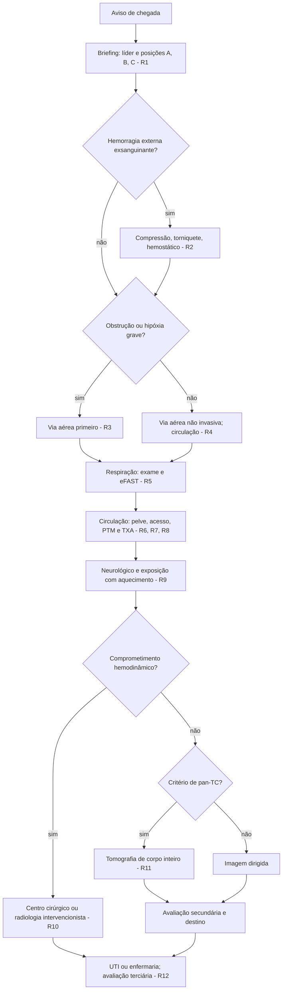

# T001 — Diretriz clínica: avaliação inicial do traumatizado na sala de trauma

> RASCUNHO para revisão (versão 2.0, 19/11/2026). Diretriz do curso CUT, adaptável a cada serviço. Reescrita no padrão de `docs/diretriz_do_tema.md`. A força e a certeza de cada recomendação são propostas do grupo de elaboração e precisam ser conferidas pelos revisores contra a graduação publicada nas diretrizes de origem.

## Escopo e população

**Pergunta clínica.** Como organizar e conduzir os primeiros minutos do atendimento ao traumatizado na sala de trauma para identificar e tratar primeiro o que mata primeiro [D1], de forma padronizada e registrada.

**Incluídos.** Toda vítima de trauma admitida na sala de trauma (sala vermelha), adulta, por qualquer mecanismo, com ou sem aviso prévio do atendimento pré-hospitalar.

**Fora desta diretriz** (seguem a diretriz do próprio tema, a partir da avaliação primária):
- gestante: ver T119 (trauma na gestante);
- criança: ver T121 (trauma na criança);
- idoso e anticoagulado: ver T007;
- grande queimado: ver T076.

## Usuários e cenário

**Para quem.** Cirurgião do trauma (líder do atendimento), residentes de cirurgia e de emergência, enfermagem e técnicos da sala de trauma, anestesiologia quando acionada.

**Onde.** Sala de trauma de hospital terciário com cirurgião 24 horas, tomografia e agência transfusional no local. Em serviço sem algum desses recursos, ver "Adaptação local".

## Definições

- **Avaliação primária.** Sequência ABCDE; quando há hemorragia externa exsanguinante ou o paciente está em extremis, a circulação vem antes da via aérea (sequência CAB ou xABCDE) [D2, D3, G1].
- **Avaliação secundária.** História dirigida (alergias, medicamentos, passado médico e gestação, última refeição, ambiente e eventos) e exame físico completo, da cabeça aos pés [D20, D21].
- **Avaliação terciária.** Novo exame completo e revisão das imagens depois da ressuscitação e das cirurgias, para encontrar a lesão que passou [D30, D31].
- **Comprometimento hemodinâmico (critério do serviço).** Qualquer um: PAS ≤ 80 mmHg; PAS ≤ 100 mmHg com TCE moderado ou grave; vasopressor ou transfusão em curso para manter a pressão; frequência cardíaca maior ou igual à PAS (índice de choque ≥ 1) [P6]. O índice de choque serve para incluir, não para excluir instabilidade [P7], e o líder pode considerar o paciente instável mesmo sem critério objetivo [P8].
- **Limiar crítico de transfusão.** Três concentrados de hemácias em qualquer período de 1 hora nas primeiras 24 horas [D37].

## Recomendações

**Recomendação 1.** Definir o líder e as funções da equipe antes da chegada do paciente, com briefing do caso e plano B combinado.
Força: forte | Certeza: baixa
Origem: própria, a partir do livro-texto [D22, D42, D71] e da ficha do serviço [P18].
Justificativa: o trabalho simultâneo e coordenado encurta o tempo até as decisões que salvam vida; a evidência é sobretudo observacional e de opinião de especialistas.
Na prática: Ponto de protocolo: o cirurgião do trauma lidera [D22]; na ausência dele, o médico mais experiente presente, até o cirurgião assumir [P22]. Posições A (via aérea e neurológico), B (ventilação) e C (choque e hemorragia) [P18]. Passagem do caso pelo atendimento pré-hospitalar em até 1 minuto, com mecanismo, lesões, sinais e tratamento [D23, D24].

**Recomendação 2.** Na hemorragia externa exsanguinante, controlar o sangramento antes da via aérea.
Força: forte | Certeza: baixa
Origem: adotada do consenso WSES e Panamerican Trauma Society 2025 [G1]; consistente com a ficha do serviço [P19].
Justificativa: na metanálise do consenso, a sequência ABC se associou a maior mortalidade que a CAB [G2], mas toda a evidência é observacional e não permite concluir causalidade [G3].
Na prática: compressão direta [D6]; no membro, torniquete proximal à lesão, fora da articulação, com a hora anotada e limite de 90 minutos [D7, D59, D60]; nas regiões juncionais (pescoço, axila, virilha), compressão com agente hemostático [D8].
Divergência: as sequências clássicas começam pela via aérea; o consenso de 2025 é a fonte mais recente e foi a seguida (regra da fonte mais recente).

**Recomendação 3.** Manter a via aérea como primeira prioridade quando houver obstrução ou hipóxia grave.
Força: forte | Certeza: baixa
Origem: adotada de [G4].
Justificativa: a obstrução e a hipóxia grave matam em minutos, antes do sangramento.
Na prática: aspiração, cânula orofaríngea, manobras e oxigênio; plano de via aérea registrado na ficha (A, B ou C) [P20].

**Recomendação 4.** No paciente em choque hemorrágico sem obstrução e sem hipóxia grave, usar via aérea não invasiva enquanto a circulação é restaurada e adiar a intubação até a ressuscitação começar.
Força: condicional | Certeza: baixa
Origem: adotada de [G6]; justificativa fisiológica em [G7] e [D47].
Justificativa: a indução, a sedação e a ventilação com pressão positiva podem desfazer a vasoconstrição compensatória e levar ao colapso [G7, D47]. No trauma penetrante exsanguinante, o Glasgow baixo costuma refletir má perfusão cerebral, e não lesão neurológica [G5].
Na prática: cânula, bolsa-válvula-máscara e oxigênio [G6]. Glasgow ≤ 8 indica via aérea definitiva, com o exame neurológico feito antes da sedação [D11, D12]. Via aérea cirúrgica pronta quando a intubação falhar (T002).

**Recomendação 5.** Avaliar a respiração com exame dirigido e eFAST, sem tomar o eFAST negativo como exclusão de pneumotórax.
Força: forte | Certeza: moderada
Origem: própria, a partir de [A30] e do livro-texto.
Justificativa: o eFAST acelera o diagnóstico, mas a sensibilidade não é perfeita [A30].
Na prática: no paciente em extremis, drenagem torácica bilateral [D48]. Hemotórax no paciente instável: controle imediato da causa [P9].

**Recomendação 6.** Na hipotensão do trauma fechado, procurar e estabilizar a pelve, com cinta pélvica bem posicionada.
Força: forte | Certeza: baixa
Origem: própria, a partir do livro-texto [D55, D56] e do indicador da WSES [G11].
Justificativa: a cinta reduz o volume pélvico e o sangramento venoso; apertada demais na compressão lateral pode aumentar o sangramento [D55].
Na prática: cinta na altura dos trocânteres; na falta, lençol e haste [D56].

**Recomendação 7.** Sem veia periférica em até poucas tentativas, usar acesso intraósseo.
Força: forte | Certeza: baixa
Origem: própria, a partir do livro-texto [D15, D46].
Justificativa: o acesso intraósseo é rápido e permite infundir hemocomponentes.
Na prática: úmero proximal como primeira escolha, salvo contraindicação; tíbia como alternativa [D15, D46].

**Recomendação 8.** Acionar o protocolo de transfusão maciça por critério objetivo ou por avaliação do líder, e administrar ácido tranexâmico até 3 horas da lesão no paciente com sangramento significativo.
Força: forte | Certeza: moderada
Origem: transfusão adaptada do protocolo do serviço [P16, P17] e do livro-texto [D33, D34, D35, D36, D37]; ácido tranexâmico adotado do protocolo AAST/ACS-COT de ressuscitação de controle de danos [G8].
Justificativa: a hipotensão prediz a necessidade de transfusão maciça [G9]; os escores têm bom valor preditivo negativo e valor preditivo positivo fraco, por isso o julgamento do líder também aciona [D34, P8].
Na prática: Ponto de protocolo: acionar se escore ABC ≥ 2 (FAST positivo, mecanismo penetrante, FC > 120, PAS < 90; um ponto cada) [D33, P16], comprometimento hemodinâmico pela definição do serviço [P6], limiar crítico de transfusão [D37] ou decisão do líder [P8]. Avisar o banco de sangue de imediato [D35]. Sequência de liberação conforme o protocolo do serviço [P17].
Divergência: o livro-texto usa índice de choque de 0,9 como corte de risco [D38]; o serviço usa 1,0 como critério de acionamento [P6]. Vale o critério do serviço, por ser o definido localmente; o corte de 0,9 fica como alerta.

**Recomendação 9.** Prevenir e tratar a hipotermia desde a chegada: despir, aquecer o ambiente, os fluidos e o paciente, e medir a temperatura.
Força: forte | Certeza: baixa
Origem: própria, a partir de [D18, D19, A36] e do indicador da WSES [G11].
Justificativa: a hipotermia piora a coagulopatia e se associa a maior mortalidade [A36].
Na prática: manta de ar forçado e aquecedor de fluidos [D19]; temperatura registrada na admissão.

**Recomendação 10.** Paciente instável não vai à tomografia para diagnóstico: vai ao controle do sangramento.
Força: forte | Certeza: baixa
Origem: adotada do protocolo de imagem do serviço, em validação [P9, P10].
Justificativa: o tempo na tomografia atrasa o controle da causa do choque.
Na prática: centro cirúrgico, ou radiologia intervencionista quando o sangramento for de controle endovascular, como na fratura pélvica grave [D40].

**Recomendação 11.** No paciente estável ou que respondeu à reposição, indicar tomografia de corpo inteiro por critério de mecanismo, clínico ou neurológico, sem esperar creatinina nem jejum.
Força: condicional | Certeza: baixa
Origem: adotada do protocolo de imagem do serviço [P2, P3, P4, P5, P12]; pan-TC não é sinônimo de qualquer trauma [P15].
Justificativa: a pan-TC encontra lesões ocultas no politraumatizado de alto risco, mas tem custo e radiação; sem critério, a imagem é dirigida pelo exame e por regras clínicas [P11].
Na prática: meta de porta-tomografia de 30 minutos, ainda pendente no protocolo do serviço [P14].

**Recomendação 12.** Fazer a avaliação terciária em todo paciente internado e tratar a hipotensão após a ressuscitação como sangramento até prova em contrário.
Força: forte | Certeza: baixa
Origem: própria, a partir do livro-texto [D30, D31, D32] e de [A42].
Justificativa: as lesões não identificadas são a complicação mais comum do atendimento inicial [A42].
Na prática: reexame completo e revisão das imagens em até 24 horas [D30].

## Fluxograma

## Quadro-resumo

| Nº | Recomendação | Força | Certeza |
|---|---|---|---|
| 1 | Líder e funções definidos antes da chegada | Forte | Baixa |
| 2 | Hemorragia externa antes da via aérea | Forte | Baixa |
| 3 | Via aérea primeiro se obstrução ou hipóxia grave | Forte | Baixa |
| 4 | No choque, via aérea não invasiva até ressuscitar | Condicional | Baixa |
| 5 | eFAST negativo não exclui pneumotórax | Forte | Moderada |
| 6 | Cinta pélvica na hipotensão do trauma fechado | Forte | Baixa |
| 7 | Intraósseo sem veia periférica | Forte | Baixa |
| 8 | Transfusão maciça por critério ou líder; TXA até 3 h | Forte | Moderada |
| 9 | Prevenir e tratar hipotermia desde a chegada | Forte | Baixa |
| 10 | Instável não vai à tomografia | Forte | Baixa |
| 11 | Pan-TC por critério no estável | Condicional | Baixa |
| 12 | Avaliação terciária em todo internado | Forte | Baixa |

## Adaptação local

Campos para o serviço preencher antes de adotar a diretriz:
- [ ] Quem lidera quando o cirurgião do trauma não está na sala, e por qual telefone é chamado:
- [ ] Protocolo de transfusão maciça vigente (anexar), hemocomponentes disponíveis e tempo até a sala:
- [ ] Ácido tranexâmico: onde fica e quem prepara:
- [ ] Tomografia 24 horas: sim ou não; tempo médio porta-tomografia:
- [ ] Radiologia intervencionista: horário disponível e como acionar:
- [ ] Sala híbrida: sim ou não:
- [ ] Serviço de referência para transferência e regulação:
- [ ] Critérios de admissão na UTI combinados com a equipe da UTI:

Sem tomografia no local: imagem dirigida e transferência regulada depois da estabilização. Sem radiologia intervencionista: fratura pélvica instável com choque vai ao tamponamento pré-peritoneal (ver o tema de pelve e fratura exposta).

## Indicadores de qualidade

Sempre como totais do mês, sem nenhum dado que identifique paciente.

| Indicador | Numerador | Denominador | Meta | Fonte do dado |
|---|---|---|---|---|
| Líder definido antes da chegada | Atendimentos com líder registrado antes da chegada | Atendimentos com aviso prévio | ≥ 90% | Ficha da sala de trauma [P18] |
| Via aérea registrada | Admissões com via aérea avaliada e registrada | Admissões de trauma | ≥ 95% | Ficha [A14] |
| Temperatura na admissão | Admissões com temperatura medida | Admissões de trauma | ≥ 90% | Ficha |
| Cinta pélvica na fratura instável | Fraturas pélvicas instáveis com cinta | Fraturas pélvicas instáveis | ≥ 90% | Registro de trauma [G11] |
| Porta-tomografia | Pacientes estáveis com pan-TC em até 30 minutos | Pacientes estáveis com pan-TC | ≥ 80% | Sistema da radiologia [P14] |
| Avaliação terciária registrada | Internados com avaliação terciária | Internados por trauma | ≥ 90% | Prontuário |

## Exceções

- **Gestante:** deslocamento uterino manual para a esquerda e avaliação obstétrica precoce (T119).
- **Anticoagulado ou antiagregado:** reversão precoce, conforme o fármaco (T007 e T114).
- **Recusa de hemocomponente** por adulto capaz: registrar a recusa e seguir com as alternativas disponíveis (T087).
- **TCE grave associado:** meta de PAS mais alta, conforme a diretriz do TCE (T040).
- **Parada cardíaca traumática:** toracotomia de reanimação conforme indicação (T019).

## Base legal e ética

- Paciente inconsciente sem responsável: o atendimento de urgência não espera consentimento; registrar a situação no prontuário (Código de Ética Médica, Resolução CFM 2.217/2018; prontuário, Resolução CFM 1.638/2002).
- Recusa de transfusão por adulto capaz: respeitar a decisão, documentar e oferecer as alternativas (Resolução CFM 2.232/2019; STF, Temas 952 e 1069, 2024). Conferir a vigência na pasta `LegislacaoBR`.
- Suspeita de violência: notificação compulsória e comunicação conforme a lei (T086).

## Método e fontes

- **Busca.** A busca do tema em `BUSCAS_PUBMED_150_temas.txt`, com filtro de diretriz dos últimos 10 anos, e as fontes já guardadas no tema.
- **Diretrizes usadas.** Consenso WSES e Panamerican Trauma Society 2025 [G1 a G7]; protocolo AAST/ACS-COT de ressuscitação de controle de danos [G8, G9]; consenso de indicadores de qualidade da WSES [G10, G11]. Protocolos do serviço: imagem no politrauma (versão preliminar, em validação) [P1 a P15], transfusão maciça [P16, P17] e ficha da sala de trauma [P18 a P22].
- **Livros-texto.** Mattox, Trauma, 9ª ed. (2021), e manual do European Trauma Course (códigos D).
- **Graduação.** Força e certeza propostas pelo grupo, pelo GRADE, a partir do desenho dos estudos citados em cada fonte; precisam ser conferidas contra a graduação publicada em cada diretriz de origem.
- **Conflito entre fontes.** Vale a mais recente, pela data de publicação; no mesmo ano, diretriz, revisão sistemática, ensaio, livro.

## Grupo de elaboração e conflitos de interesse

- **Redação do rascunho:** agente produtor do CUT, sob supervisão da coordenação.
- **Coordenação:** [nome do coordenador], [instituição]. Conflitos de interesse: [declarar].
- **Revisores:** [nomes, após a autorização de cada um pelo termo de autorização e declaração de conflitos de interesse]. Conflitos de interesse: [declarar].
- **Aprovação:** [data e instância].

## Limitações e lacunas

- A ordem CAB contra ABC não tem ensaio randomizado; toda a evidência é observacional [G3].
- O protocolo de imagem do serviço ainda está em validação [P1], e a meta de porta-tomografia está pendente [P14].
- Critérios de admissão na UTI sem fonte carregada: precisam ser validados com a UTI.
- **Perguntas para pesquisa:** o efeito do briefing com funções definidas sobre o tempo até a intervenção no serviço; a adesão à avaliação terciária e o número de lesões não identificadas antes e depois da diretriz; o desempenho do escore ABC contra o julgamento do líder no acionamento da transfusão maciça.

## Revisão

- Versão 2.0, 19/11/2026: reescrita no padrão de diretriz clínica (recomendações graduadas, fluxograma, adaptação local, indicadores e governança). A versão anterior fica em `conteudo/T001/arquivo/protocolo_ate_2026-11-19.md`.
- Próxima revisão: novembro de 2028, ou antes se for publicada nova versão de uma das diretrizes de origem ou se o protocolo de imagem do serviço for aprovado.
