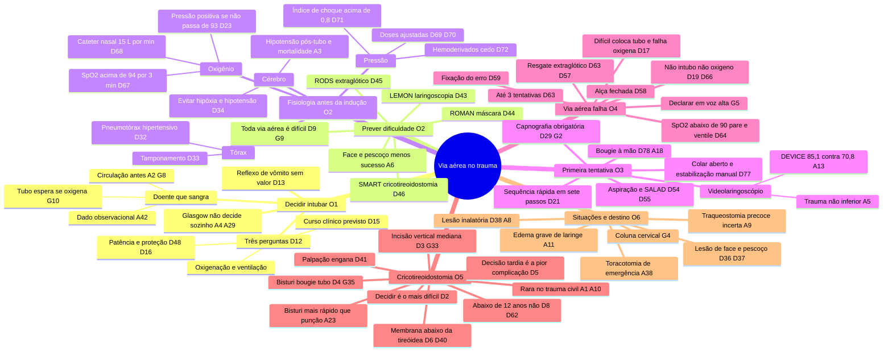

> RASCUNHO para revisão. Códigos entre colchetes remetem a afirmacoes.csv, com o trecho literal da fonte. Dentro do diagrama, os códigos aparecem sem colchetes.

# T002 — Mapa conceitual

O mapa resume o caminho de decisão do tema, da indicação ao destino da via aérea de resgate. Cada ramo corresponde a uma seção do resumo básico e a um objetivo (T002-O1 a T002-O6).

## Como ler

- O ramo da decisão de intubar [D12, A4, A29, A2, G8, G10, A42] vem antes de qualquer técnica: no doente que sangra e oxigena, o tubo pode esperar a correção hemodinâmica.
- A previsão da dificuldade [D9, D43, D44, D45, D46, A6] e o preparo da fisiologia [D67, D68, D23, D71, D72, D69, D70, D32, D33, D34, A3] acontecem antes da primeira dose.
- A primeira tentativa [D21, A13, A5, D78, A18, D54, D55, D77, D29, G2] é a que mais pesa no desfecho.
- A via aérea falha [D17, D64, D63, D57, G5, D58, D59, D19, D66] é declarada em voz alta: até 3 tentativas no curso, sem esperar a contagem quando não há oxigenação.
- A cricotireoidostomia [D2, D5, D6, D40, D41, D4, G35, D3, G33, A23, D8, D62, A1, A10] tem a incisão vertical mediana como padrão do curso.
- As situações especiais e o destino da via aérea [D36, D37, A11, D38, A8, G4, A9, A38] são aprofundados nos temas T044, T077, T043, T099 e T019.
