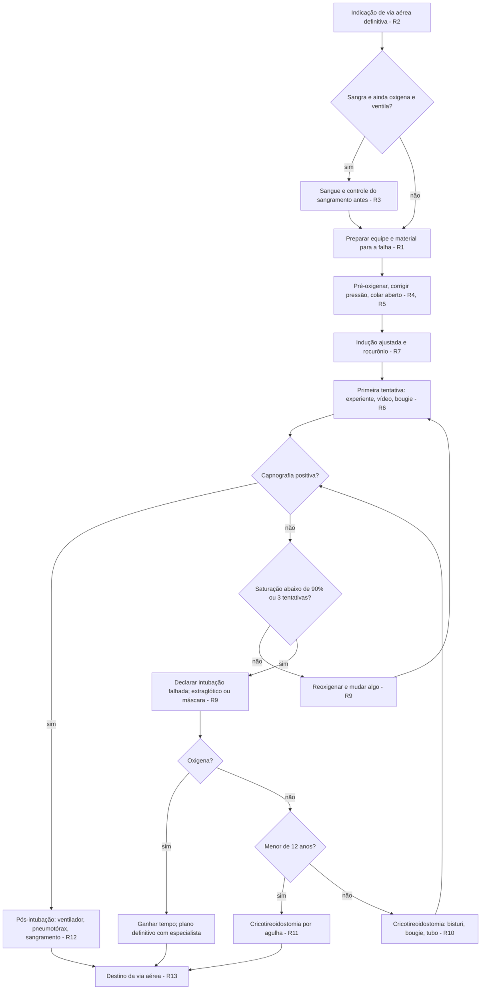

> RASCUNHO para revisão (versão 1.1, 19/11/2026). Guia do curso CUT, adaptável a cada serviço. A força e a certeza de cada recomendação são propostas do grupo de elaboração e precisam ser conferidas pelos revisores contra a graduação publicada em cada diretriz de origem.

# T002 — Proposta de guia de atendimento: via aérea definitiva no traumatizado na sala de trauma

> PROPOSTA para avaliação da diretoria e validação pelas equipes listadas em "Equipes para validação". Não é norma vigente nem diretriz validada.

Diretriz clínica, fluxo de atendimento e regulação, qualidade e segurança do paciente.

Proposta dirigida à Unidade de Emergência do Hospital das Clínicas da Faculdade de Medicina de Ribeirão Preto da USP (UE-HCFMRP). A "Adaptação local" foi preenchida com as respostas da coordenação de 19/11/2026; o serviço parte do nível 0 de maturidade.

## Escopo e população

**Pergunta clínica.** No adulto traumatizado atendido na sala de trauma, como decidir e conduzir a via aérea definitiva, reconhecer a via aérea falha e fazer a cricotireoidostomia sem atraso?

**Incluídos.** Toda vítima de trauma na sala de trauma (sala vermelha) que precise de oxigenação, ventilação ou proteção da via aérea, com ou sem intubação no pré-hospitalar.

**Fora desta diretriz** (seguem o tema próprio, a partir do que este guia define):
- avaliação inicial e acionamento da equipe: T001;
- criança: T121 e T108 (este guia só define o limite de idade da cricotireoidostomia cirúrgica);
- lesão cervical penetrante e de estruturas aerodigestivas: T044;
- trauma de face: T043; lesão inalatória: T077;
- TCE grave, metas de PIC e PPC: T040;
- traqueostomia e via aérea prolongada: T099.

## Usuários e cenário

Escrita para quem intuba e para quem faz o resgate cirúrgico na sala de trauma: cirurgião do trauma, emergencista, anestesista, residentes, enfermagem da sala. Aplica-se à sala de trauma, ao transporte intra-hospitalar e à sala de tomografia; no centro cirúrgico, vale a rotina da anestesia, com a cricotireoidostomia como resgate comum aos dois ambientes.

## Definições

- **Via aérea definitiva.** Tubo com balonete na traqueia [D47].
- **Via aérea difícil.** Situação em que o objetivo ainda é colocar o tubo [D17].
- **Via aérea falha.** Situação em que o objetivo passa a ser oxigenar por qualquer meio [D17]; inclui a saturação que não se mantém durante ou depois da tentativa perdida [D1].
- **Não intubo, não oxigeno.** Falha da intubação e da ventilação com bolsa-máscara e com dispositivo de resgate; indica a via aérea cirúrgica [D85, D86].
- **Índice de choque.** Frequência cardíaca dividida pela pressão sistólica; acima de 0,8, aumenta o risco de hipotensão peri-intubação [D71].
- **Tentativa.** Cada introdução do laringoscópio na boca com intenção de intubar; o limite é contado por operador [D84].

## Recomendações

**Recomendação 1.** Antes da indução, preparar a equipe e o material para a falha: funções distribuídas, pausa pré-intubação com o plano dito em voz alta e o material da via aérea cirúrgica aberto.
Força: forte | Certeza: consenso de especialistas
Origem: adotada de [G22] e da doutrina de livro-texto [D18, D58, D60]; material da [G35].
Justificativa: o sucesso depende mais do sistema que apoia o profissional do que da habilidade individual [D60]; a complicação mais grave da via aérea cirúrgica é a hipóxia por decisão tardia [D5].
Na prática: Ponto de protocolo: quem intuba, quem ventila, quem segura a cabeça, quem aspira e quem olha saturação e relógio; bisturi com lâmina 10, bougie e tubo 6,0 abertos antes da primeira dose [G35, D18]; checklist pré-intubação [G22]. Na UE-HCFMRP, o checklist atual não é usado: este guia propõe um novo, com o registro da intubação, na ficha proposta da seção "Implantação".

**Recomendação 2.** Decidir a intubação pelas três perguntas (proteção, oxigenação e ventilação, curso previsto), sem usar o Glasgow como critério único.
Força: forte | Certeza: baixa
Origem: adotada de [G3]; doutrina de [D12]; Glasgow isolado em [A4, A29].
Justificativa: o Glasgow abaixo de 8, sozinho, não separa com segurança risco de aspiração, oxigenação ruim ou benefício de sobrevida [A29].
Na prática: voz clara é forte indício de via aérea pérvia e protegida [D48]; os sinais de obstrução alta são voz abafada, dificuldade de deglutir secreções, estridor e dispneia [D16]; não testar o reflexo de vômito [D13].

**Recomendação 3.** No paciente em choque hemorrágico que mantém a via aérea, oxigena e ventila, começar sangue e controlar o sangramento antes do tubo.
Força: condicional | Certeza: baixa
Origem: adotada de [G10]; apoio observacional em [A2, G8].
Justificativa: a indução e a pressão positiva podem precipitar o colapso [D30, D33]; o dado a favor de adiar é observacional, com grupos diferentes desde a chegada [A41, A42].
Na prática: via aérea básica, oxigênio e gatilho combinado para intubar (obstrução, hipóxia que não cede); hemoderivados o quanto antes [D72]. Igual à recomendação 4 do guia do T001.
Divergência: o consenso WSES-Panamerican de 2025 sustenta a prioridade da circulação [G8, G25]; o ATLS 11 mantém o xABCDE, em que só a hemorragia externa exsanguinante vem antes da via aérea (guia do T001). As duas se conciliam no adiamento da via aérea invasiva, não da via aérea básica.

**Recomendação 4.** Preparar a fisiologia antes da indução: pré-oxigenar, corrigir a pressão e proteger o cérebro.
Força: forte | Certeza: moderada
Origem: adaptada do livro-texto [D67, D23, D71, D72] e dos ensaios em adultos críticos [A14, A15] (evidência indireta).
Justificativa: a hipotensão pós-intubação associou-se a maior mortalidade em 30 dias no TCE grave com politrauma [A3]; ventilação não invasiva e bolsa-máscara reduziram a hipoxemia na intubação [A14, A15].
Na prática: saturação acima de 94% por 3 minutos [D67]; pressão positiva se não passar de 93% [D23]; cateter nasal a 15 L/min durante a laringoscopia [D68]; índice de choque acima de 0,8: indutor reduzido, sangue correndo e adrenalina em bolus preparada [D69, D72, D73]; terapia hiperosmolar antes na suspeita de hipertensão intracraniana [A35]; procurar pneumotórax e tamponamento antes da indução [D32, D33]. O bolus rotineiro de fluido não reduziu o colapso em críticos [A20].

**Recomendação 5.** Abrir a frente do colar cervical e manter a restrição manual do movimento cervical durante a intubação e a cricotireoidostomia.
Força: forte | Certeza: baixa
Origem: adotada de [D87, D77, D11]; diretriz multissociedade em [G4].
Justificativa: o colar fechado atrapalha a abertura da boca e o acesso ao pescoço; a diretriz de 2024 reúne 23 recomendações, com evidência em geral modesta [G4].
Na prática: um assistente segura a cabeça em posição neutra; só a parte da frente do colar sai [D87].

**Recomendação 6.** Fazer da primeira tentativa a melhor: operador mais experiente, videolaringoscópio, bougie ou estilete e o melhor posicionamento possível.
Força: forte | Certeza: moderada
Origem: adotada do ATLS 11 [D81] e da DAS 2025 [G13]; evidência em [A5, A13].
Justificativa: no trauma, o videolaringoscópio teve sucesso na primeira tentativa não inferior ou maior que a laringoscopia direta [A5]; em críticos, 85,1% contra 70,8% (evidência indireta) [A13].
Na prática: tela visível para a equipe [D81]; aspirador rígido de forma proativa na via aérea com sangue [D55]. Bougie e fio-guia não diferiram no ensaio BEST, em traumatizados [A19]. Na UE-HCFMRP, a primeira tentativa hoje é do residente da emergência ou da cirurgia, em rodízio; a proposta do curso para essa diferença está na "Adaptação local".
Divergência: a EAST de 2012 recomendava a laringoscopia direta [G24]; vale a fonte mais recente (ATLS 11, 2026, e DAS 2025).

**Recomendação 7.** Na sequência rápida, reduzir a dose do indutor no choque e usar rocurônio em 1,2 mg/kg ou mais como bloqueador de primeira escolha.
Força: condicional | Certeza: baixa
Origem: adaptada do ATLS 11 [D82, D83] e do livro-texto [D69, D70]; revisão em [A26].
Justificativa: o rocurônio em 1,2 mg/kg ou mais dá as mesmas condições de intubação com menos efeitos colaterais [D82]; a succinilcolina pode causar hiperpotassemia grave com tecido desnervado ou necrótico [D83]. Cetamina e etomidato não diferiram em mortalidade em críticos, com mais colapso cardiovascular com cetamina [A16, A17].
Na prática: etomidato 0,3 mg/kg ou cetamina 1,5 mg/kg, reduzidos até 50% com índice de choque acima de 0,8 [D69]; rocurônio 1,2 mg/kg, aumentado 25% com índice de choque acima de 0,8 [D70]; com rocurônio, sedação garantida depois do tubo, porque o bloqueio dura [D80]. Na UE-HCFMRP, rocurônio e sugamadex não ficam na sala (vêm da farmácia): a proposta é manter o rocurônio na sala; até lá, succinilcolina 1,5 mg/kg no paciente sem contraindicação [D70, D74], com a checagem das contraindicações [D75, D76, D83], e rocurônio pedido à farmácia já na decisão de intubar quando houver contraindicação.
Divergência: a EAST de 2012 e o livro-texto de 2021 mantinham a succinilcolina como padrão [G12, D74]; vale a fonte mais recente (ATLS 11, 2026).

**Recomendação 8.** Confirmar toda intubação, oral ou pelo pescoço, por capnografia em forma de onda.
Força: forte | Certeza: moderada
Origem: adotada de [G2] e [D29].
Justificativa: a detecção de CO2 expirado é obrigatória para confirmar o tubo [D29]; o colorimétrico pode falhar na parada prolongada, e o ultrassom ajuda a confirmar a ventilação [D61, A36].
Na prática: curva sustentada e ausculta bilateral [D91]; profundidade anotada na comissura labial [G18]. Na UE-HCFMRP não há capnógrafo em forma de onda disponível para a sala: a aquisição é requisito do nível 1 (passo 4 da implantação). Também não há detector colorimétrico; hoje a confirmação é feita por ausculta e saturação, que não bastam [D29]. Até a chegada do capnógrafo, a proposta é somar o ultrassom (disponível) à ausculta para confirmar a ventilação [A36], com o registro do método usado.

**Recomendação 9.** Limitar as tentativas, interromper com saturação abaixo de 90% e declarar a falha em voz alta.
Força: forte | Certeza: consenso de especialistas
Origem: adotada do ATLS 11 [D84, D86] e do livro-texto [D64]; WTA em [G6, G7]; decisão da coordenação de 19/11/2026 (até 3 tentativas).
Justificativa: cada tentativa aumenta edema e obstrução [D84]; enquanto ninguém declara a falha, a equipe continua na tentativa anterior [G5].
Na prática: Ponto de protocolo: no máximo 3 tentativas por operador, com uma a mais por operador mais experiente [D84]; nenhuma nova tentativa sem reoxigenar e mudar algo [G21, G23]; saturação abaixo de 90% interrompe e ventila [D64]; o líder declara "intubação falhada" [D86].
Divergência: o manual de Walls define falha com 2 tentativas [D1]; a WTA admite a via cirúrgica após a primeira falha na via aérea distorcida [G7]. O curso adota o limite de 3, que não obriga a fazer 3.

**Recomendação 10.** No não intubo, não oxigeno, fazer a cricotireoidostomia cirúrgica com bisturi, bougie e tubo, com incisão de pele vertical, sem esperar a contagem de tentativas.
Força: forte | Certeza: baixa
Origem: adotada do ATLS 11 [D86 a D91] e da DAS 2025 [G33, G34, G35, G36, G37]; metanálise em [A23].
Justificativa: a técnica com bisturi foi mais rápida que a por punção, sem diferença no sucesso, com baixa certeza [A23]; a incisão vertical serve à membrana palpável e à impalpável [G34].
Na prática: Ponto de protocolo: uma tentativa de extraglótico em paralelo, sem esperar o resultado [D19]; bloqueio neuromuscular completo [G37]; laringe presa pela mão não dominante [D87]; pele vertical de 3 a 5 cm, estendida até palpar a membrana [D88]; membrana transversal na porção inferior [D89, D96]; cabo do bisturi para dilatar e dedo para confirmar [D90]; bougie e tubo 6,0 até o balonete [D90, D91, G35]; capnografia e sutura [D91].
Divergência: a DAS 2025 pede extensão máxima do pescoço [G38], o que o trauma com restrição cervical pode impedir; no curso, o pescoço fica neutro e a membrana é achada pela mão.

**Recomendação 11.** Abaixo de 12 anos, não fazer a cricotireoidostomia cirúrgica; o resgate é a cricotireoidostomia por agulha.
Força: forte | Certeza: consenso de especialistas
Origem: adotada do livro-texto [D8, D62]; decisão da coordenação de 19/11/2026.
Justificativa: na criança, a laringe é mais alta e a membrana proporcionalmente menor [D102].
Na prática: punção da membrana e ventilação transtraqueal até a via aérea definitiva; tema próprio da via aérea pediátrica.
Divergência: a idade mínima é controversa, de 5 a 12 anos conforme a fonte [D92, D7, A25]; o curso adota 12 anos.

**Recomendação 12.** Depois do tubo, tratar a hipotensão como problema de ventilador, pneumotórax ou sangramento até prova em contrário, e no TCE buscar eucapnia e normoxia.
Força: forte | Certeza: baixa
Origem: adotada de [G20] e [D53]; TCE em [A34, D35].
Justificativa: a pressão positiva pode transformar pneumotórax simples em hipertensivo [D32]; a hiperventilação piora os desfechos no TCE [D35].
Na prática: conferir o ventilador, procurar pneumotórax hipertensivo e sangramento em curso, nessa ordem [G20]; com pneumotórax já identificado, drenar junto com a intubação [G19].

**Recomendação 13.** Definir, no mesmo dia, quem decide e quando se faz o destino da via aérea cirúrgica.
Força: condicional | Certeza: muito baixa
Origem: própria, a partir de [D91] e [A9].
Justificativa: a cricotireoidostomia é ponte; o tubo é trocado quando o paciente melhora e há especialista em via aérea [D91]; o efeito do momento da traqueostomia sobre a mortalidade no politrauma é muito incerto [A9].
Na prática: na UE-HCFMRP, a conversão é feita pela cirurgia de cabeça e pescoço ou pela cirurgia de urgência, em cerca de 48 horas (prática atual); técnica no T099.

## Fluxograma

## Quadro-resumo

| Recomendação | Força | Certeza |
|---|---|---|
| R1 Equipe e material para a falha antes da indução | Forte | Consenso de especialistas |
| R2 Decidir pelas três perguntas, não pelo Glasgow isolado | Forte | Baixa |
| R3 No choque que oxigena, sangue antes do tubo | Condicional | Baixa |
| R4 Pré-oxigenar, corrigir pressão, proteger o cérebro | Forte | Moderada |
| R5 Colar aberto na frente, restrição manual | Forte | Baixa |
| R6 Primeira tentativa: experiente, vídeo, bougie, posição | Forte | Moderada |
| R7 Indutor reduzido no choque; rocurônio 1,2 mg/kg | Condicional | Baixa |
| R8 Capnografia em forma de onda em todo tubo | Forte | Moderada |
| R9 Até 3 tentativas; saturação abaixo de 90% interrompe; declarar a falha | Forte | Consenso de especialistas |
| R10 Não intubo, não oxigeno: bisturi, bougie, tubo, pele vertical | Forte | Baixa |
| R11 Abaixo de 12 anos: agulha | Forte | Consenso de especialistas |
| R12 Hipotensão depois do tubo: ventilador, pneumotórax, sangramento | Forte | Baixa |
| R13 Destino da via aérea cirúrgica definido no mesmo dia | Condicional | Muito baixa |

## Fluxo de atendimento e regulação

| Etapa | Gatilho de entrada | O que acontece (recomendações) | Responsável | Tempo-alvo | Registro |
|---|---|---|---|---|---|
| 1. Decisão | Avaliação primária com indicação de via aérea definitiva | Três perguntas; no choque que oxigena, sangue antes (R2, R3) | Líder do atendimento | Sem meta: decisão contínua | Ficha da sala de trauma |
| 2. Preparação | Decisão de intubar | Funções, checklist, material do pescoço aberto, fisiologia (R1, R4, R5) | Quem intuba; enfermagem da sala | [meta a definir pelo serviço] | Checklist pré-intubação |
| 3. Intubação | Fim da preparação | Indução ajustada, primeira tentativa, capnografia (R6, R7, R8) | Quem intuba | Sem meta: registrar tentativas e saturação mínima | Registro da intubação |
| 4. Falha e resgate | Saturação abaixo de 90%, 3 tentativas ou não intubo, não oxigeno | Declarar; extraglótico; cricotireoidostomia (R9, R10, R11) | Líder declara; quem faz o pescoço executa | Sem meta: medir o tempo da declaração à incisão | Registro da intubação |
| 5. Pós-intubação | Tubo confirmado | Hipotensão, ventilação, sedação (R12) | Quem intuba; líder | Sem meta | Ficha da sala de trauma |
| 6. Destino | Via aérea cirúrgica ou difícil | Responsável e prazo da conversão (R13) | Cirurgia de cabeça e pescoço ou cirurgia de urgência | Decisão no mesmo dia (proposta do curso); conversão em cerca de 48 horas (prática atual da UE) | Prontuário |

### Regulação

A via aérea não muda a entrada do paciente, regulada como no guia do T001. O que muda é a saída: o paciente com via aérea cirúrgica ou com via aérea difícil registrada vai à UTI com essa informação na passagem, e a vaga é pedida ao núcleo interno de regulação na decisão de destino, como no T001. Transferência para outro serviço só com via aérea definitiva confirmada por capnografia.

### Passagem de cuidado

A passagem para a UTI ou para o centro cirúrgico diz, nesta ordem: tipo de via aérea (oral ou pelo pescoço), número de tentativas, dispositivo, saturação mínima, fármacos e horário, se houve resgate e o plano de destino. É sugestão do curso, no formato estruturado do serviço.

## Matriz de responsabilidades

R = executa; A = responde pelo resultado; C = consultado; I = informado. Sugestão do curso: o serviço confirma na implantação.

| Atividade | Líder do atendimento | Quem intuba | Anestesiologia | Cirurgião do trauma | Enfermagem da sala | Coordenação do serviço | Comissão de qualidade e segurança |
|---|---|---|---|---|---|---|---|
| Decidir a intubação | A, R | C | C | C | I | — | — |
| Montar o material e o kit do pescoço | A | R | C | C | R | — | — |
| Pausa pré-intubação | A | R | C | I | R | — | — |
| Intubar | A | R | C | I | R | — | — |
| Declarar a falha | A, R | R | C | I | I | — | — |
| Cricotireoidostomia | A | — | C | R | R | — | — |
| Registrar a intubação | A | R | — | — | R | — | — |
| Conferir o kit do pescoço diariamente | — | — | — | — | R | A | I |
| Treinar a equipe em simulação | — | R | R | R | R | A | I |
| Coleta mensal dos indicadores | — | — | — | — | R | A | I |

Na UE-HCFMRP hoje: quem intuba é o residente da emergência ou da cirurgia, em rodízio, na primeira tentativa, e o chefe da emergência ou da cirurgia da segunda tentativa em diante; a anestesiologia, presente 24 horas no centro cirúrgico, é chamada por telefone depois que os chefes da emergência e do trauma não conseguem; a cricotireoidostomia é feita pela equipe de cirurgia (residente e preceptor).

## Indicadores de qualidade

Sempre como totais do mês, sem nenhum dado que identifique paciente. Metas com fonte quando houver; as demais são propostas do curso para o serviço confirmar.

| Indicador | Tipo | Numerador | Denominador | Meta | Fonte do dado | Periodicidade | Coleta | Análise |
|---|---|---|---|---|---|---|---|---|
| Kit da via aérea cirúrgica conferido | Estrutura | Dias com o kit conferido e completo | Dias do mês | ≥ 95% (proposta) | Folha de conferência da sala | Mensal | Enfermagem da sala | Coordenação do serviço |
| Pausa pré-intubação feita | Processo | Intubações na sala com checklist registrado | Intubações na sala | ≥ 90% (proposta) (R1) [G22] | Registro da intubação | Mensal | Enfermagem da sala | Coordenação do serviço |
| Confirmação por capnografia | Processo | Intubações confirmadas por capnografia registrada | Intubações na sala | ≥ 95% (proposta) depois da chegada do capnógrafo à sala; até lá, o indicador mede a lacuna (R8) [D29] | Registro da intubação | Mensal | Enfermagem da sala | Comissão de qualidade |
| Sucesso na primeira tentativa | Resultado | Intubações com sucesso na primeira tentativa | Intubações na sala | ≥ 85% (proposta; valor observado em coorte de trauma [A22]) (R6) | Registro da intubação | Mensal | Quem intuba | Coordenação do serviço |
| Mais de 3 tentativas por operador | Processo | Intubações com mais de 3 tentativas pelo mesmo operador | Intubações na sala | 0% (proposta) (R9) [D84] | Registro da intubação | Mensal | Quem intuba | Comissão de qualidade |
| Hipoxemia na intubação | Resultado | Intubações com saturação abaixo de 90% durante o procedimento | Intubações na sala | Sem meta: linha de base de 3 meses (R4) | Registro da intubação | Mensal | Enfermagem da sala | Comissão de qualidade |
| Hipotensão ou parada após a intubação | Resultado | Intubados na sala com PAS < 90 mmHg ou parada até 10 minutos após o tubo | Intubados na sala | Sem meta: linha de base de 3 meses (R4, R12) [A3]; mesmo indicador do guia do T001 | Registro da intubação | Mensal | Enfermagem da sala | Comissão de qualidade |
| Tempo da declaração de falha à incisão | Processo | Mediana, em minutos, entre o "não intubo, não oxigeno" e a incisão | Cricotireoidostomias no período | Sem meta: todos os casos revistos na morbimortalidade (R10) [D5] | Registro da intubação | A cada caso | Líder do atendimento | Comissão de qualidade |
| Equipe treinada em simulação | Estrutura | Residentes e médicos da sala com simulação de via aérea cirúrgica no ano | Residentes e médicos da sala | ≥ 90% (proposta) [G31] | Registro do treinamento | Anual | Coordenação do serviço | Comissão de qualidade |

## Monitoramento e melhoria

- **Coleta.** Até o 5º dia útil de cada mês, os totais do mês anterior entram na planilha de totais do serviço, sem dado de paciente.
- **Análise.** Mensal, na reunião da coordenação do serviço, com o gráfico de cada indicador e a meta; com 12 meses ou mais, gráfico de controle.
- **Gatilhos de ação.** Indicador abaixo da meta por 3 meses seguidos vai à comissão de qualidade, com análise de causa e ciclo de melhoria com responsável e prazo. Qualquer intubação com mais de 3 tentativas por operador é revista no mês.
- **Revisão de casos.** Vão sempre à reunião de morbimortalidade: toda cricotireoidostomia, toda parada durante ou logo após a intubação, todo tubo esofágico não reconhecido e toda via aérea falha.
- **Auditoria.** A cada trimestre, amostra de registros de intubação conferida contra o prontuário (tentativas, saturação mínima, capnografia).
- **Relatório à diretoria.** Semestral.

## Segurança do paciente

| Risco | Como acontece | Barreira prevista neste guia | Protocolo básico de segurança relacionado | Notificar ao núcleo de segurança do paciente |
|---|---|---|---|---|
| Hipóxia por insistência | Tentativas repetidas sem reoxigenar, falha não declarada | Limite de tentativas, saturação abaixo de 90% interrompe, falha declarada (R9) [D84, D64] | Comunicação efetiva | Via aérea falha com dano |
| Tubo esofágico não reconhecido | Confirmação só pela ausculta | Capnografia em forma de onda em todo tubo (R8) [D29] | — | Tubo esofágico com dano |
| Colapso na indução | Choque não corrigido, dose cheia | Sangue antes, dose reduzida, adrenalina pronta (R3, R4, R7) [D69, D72, D73] | Segurança na prescrição e administração de medicamentos | Parada durante a intubação |
| Hiperpotassemia pela succinilcolina | Queimadura antiga, imobilização, lesão medular | Rocurônio como primeira escolha (R7) [D82, D83]; enquanto o rocurônio não estiver na sala, checagem das contraindicações na pausa pré-intubação [D75, D76] | Segurança na prescrição de medicamentos | Arritmia ou parada ligada ao fármaco |
| Tubo pelo pescoço fora da traqueia | Membrana não estabilizada, tubo sem bougie | Laringe presa, dedo, bougie, capnografia (R10) [D87, D90, D97] | — | Falso trajeto com dano |
| Kit incompleto na hora | Material usado e não reposto | Conferência diária do kit (indicador) | — | Falta de material em emergência |
| Lesão cervical agravada | Colar fechado e movimentação do pescoço | Restrição manual com a frente do colar aberta (R5) [D87] | — | Déficit novo após manipulação |

## Adaptação local

Para a UE-HCFMRP, com as respostas da coordenação de 19/11/2026. Outro serviço que adote o guia refaz esta seção. O que está marcado "proposta do curso" é sugestão para a validação pelas equipes, não prática atual.

| Ponto | UE-HCFMRP hoje | Proposta do curso |
|---|---|---|
| Quem intuba | Residente da emergência ou da cirurgia, em rodízio, na primeira tentativa; chefe da emergência ou da cirurgia da segunda em diante | Na via aérea difícil prevista (sangue ou deformidade da face, edema, lesão inalatória, choque com índice acima de 0,8, obesidade, LEMON positivo), a primeira tentativa é do R3, residente mais experiente da sala [D81, D9]; na via aérea prevista sem dificuldade, segue o rodízio, com o chefe na sala; da segunda tentativa em diante, o chefe (decisão da coordenação de 19/11/2026) |
| Quem faz a cricotireoidostomia | Equipe de cirurgia (residente e preceptor) | Mantida; o cirurgião que fará o pescoço participa da pausa pré-intubação (R1) |
| Anestesiologia | 24 horas no centro cirúrgico; chamada por telefone depois que os chefes da emergência e do trauma não conseguem | Na via aérea difícil prevista (a da primeira tentativa pelo R3), o anestesista é avisado logo após a primeira falha, sem mudar quem intuba (decisão da coordenação de 19/11/2026) |
| Material na sala 24 horas | Videolaringoscópio (diversas marcas), bougie, máscara laríngea e ultrassom: sim. I-gel, capnógrafo em forma de onda e endoscópio flexível: não disponíveis para a sala | Capnógrafo em forma de onda na sala como requisito do nível 1 (R8); hoje não há detector colorimétrico, e a confirmação é por ausculta e saturação |
| Kit de cricotireoidostomia | Pronto na sala (bisturi lâmina 10, bougie, tubo 6,0, gancho) | Conferência diária, com indicador; sequência impressa na tampa |
| Fármacos na sala | Succinilcolina, cetamina, etomidato e propofol 24 horas; rocurônio e sugamadex só na farmácia | Rocurônio na sala (R7); até lá, succinilcolina sem contraindicação e rocurônio pedido na decisão de intubar quando houver contraindicação |
| Checklist e registro | Há checklist; a intubação é anotada no prontuário depois da tentativa, já com o desfecho | O checklist atual não é usado: nova ficha de checklist pré-intubação e registro da intubação, na seção "Implantação" |
| Treinamento em simulação | Sem treinamento formal periódico; proficiência mantida por cada médico | Simulação de via aérea falha e de cricotireoidostomia a cada entrada de residentes e a cada 6 meses para a equipe fixa |
| Destino da via aérea cirúrgica | Conversão pela cirurgia de cabeça e pescoço ou pela cirurgia de urgência, em cerca de 48 horas | Responsável definido no mesmo dia e registrado na passagem (R13) |
| Nível de maturidade | 0 (ponto de partida definido pela coordenação) | Passo a passo até o nível 5 na seção "Implantação" |
| Responsáveis pelos indicadores | Por cargo, como na tabela de indicadores (resposta do T001) | — |
| Número mínimo de casos por período | 20 (resposta do T001) | — |
| Metas dos indicadores | Propostas do curso, aceitas no T001 | A confirmar para este guia na validação |

Para serviços com menos recursos: sem videolaringoscópio, laringoscopia direta com bougie à mão [D78]; sem capnografia em forma de onda, detector colorimétrico, sabendo que ele pode falhar na parada prolongada [D61], e ultrassom para confirmar a ventilação [A36].

## Implantação

A implantação segue o modelo de maturidade do curso CUT: seis níveis, do serviço sem protocolo (nível 0) ao serviço com tudo implantado e desempenho no percentil 90 (P90) da referência internacional (nível 5). Só se passa ao nível seguinte quando os critérios de saída do nível atual se mantêm pelo período pedido, com o número mínimo de casos definido na "Adaptação local".

### Níveis de maturidade deste guia

| Nível | Objetivo | Marcadores e indicadores do T002 | Critério para passar ao nível seguinte |
|---|---|---|---|
| 0. Sem protocolo | Saber de onde parte | Diagnóstico: material da sala, fármacos, quem intuba, kit do pescoço, registro da intubação, número de intubações por mês; responsável pelo guia nomeado | Proposta entregue à diretoria e equipes da validação convidadas |
| 1. Formalizado | Regra escrita, aceita e conhecida | Pareceres das equipes; "Adaptação local" preenchida; kit do pescoço conferido; capnógrafo e rocurônio na sala; nova ficha de checklist e registro em uso; equipe treinada; linha de base dos 9 indicadores | Guia aprovado com data e instância; ≥ 80% da equipe fixa treinada (proposta); 3 meses de linha de base |
| 2. Em uso | Fazer o que está escrito, sempre, e registrar | Kit conferido; pausa pré-intubação; capnografia em todo tubo; tentativas limitadas | Registro da intubação em ≥ 90% e esses 4 indicadores na meta por 3 meses seguidos |
| 3. Gerenciado | Corrigir desvios de forma sistemática | Os 9 indicadores no painel; ciclos de melhoria; toda cricotireoidostomia revista; auditoria trimestral | Todos os indicadores de processo na meta por 6 meses; todo gatilho com plano; auditoria com concordância ≥ 90% (proposta) |
| 4. Comparado | Saber onde o serviço está em relação aos melhores | Sucesso na primeira tentativa, hipoxemia e hipotensão comparados com registros publicados de intubação no trauma [A22, A1] | 12 meses de dados; indicadores comparáveis na mediana da referência ou acima |
| 5. Excelência | Ser referência e manter | Percentil do serviço em cada indicador comparável; tempo sustentado no P90; projetos do banco de pesquisa | Manter no P90 por 12 meses; queda por 3 meses volta o indicador ao nível 4 |

**Referência para o P90.** [percentil 90 sem referência publicada carregada neste tema: usar a meta interna sustentada por 12 meses. A coorte canadense de trauma registrou 85% de sucesso na primeira tentativa [A22], valor de comparação, não percentil.]

### Execução passo a passo (do nível 0 ao nível 5)

| Passo | O que entregar | Quem responde | Prazo sugerido | Nível ao terminar |
|---|---|---|---|---|
| 1. Diagnóstico | Material, fármacos, quem intuba, kit do pescoço e registro atuais; responsável nomeado | Coordenação do serviço | Semana 1 | 0 |
| 2. Apresentação | Esta proposta entregue à diretoria | Coordenação do serviço | Semana 2 | 0 → 1 |
| 3. Validação pelas equipes | Parecer de cada equipe de "Equipes para validação" | Cirurgia de urgência e trauma (conduz) | Semanas 2 a 6 | 1 |
| 4. Adaptação local e material | "Adaptação local" aprovada; capnógrafo em forma de onda e rocurônio na sala; kit do pescoço conferido; nova ficha de checklist e registro da intubação em uso | Coordenação do serviço e enfermagem | Semanas 4 a 8 | 1 |
| 5. Linha de base | Indicadores medidos por 3 meses | Comissão de qualidade | 3 meses (junto dos passos 3 e 4) | 1 |
| 6. Treinamento | Simulação de via aérea falha e de cricotireoidostomia para residentes, médicos e enfermagem da sala (procedimento com métrica no T097); depois, a cada entrada de residentes e a cada 6 meses | Coordenação do serviço | Antes do piloto | 1 |
| 7. Piloto | Guia em uso, com acompanhamento mensal | Quem intuba e líderes do atendimento | 3 meses | 1 → 2 |
| 8. Rotina | Ajustes do piloto incorporados; nova versão para aprovação | Diretoria e comissão de qualidade | Fim do piloto | 2 |
| 9. Rotina sustentada | Registro em ≥ 90% e os 4 indicadores do nível 2 na meta por 3 meses | Enfermagem da sala e quem intuba | Meses 1 a 3 da rotina | 2 → 3 |
| 10. Painel mensal | Os 9 indicadores no painel, com gatilhos | Comissão de qualidade | A partir do mês 4 da rotina | 3 |
| 11. Ciclos de melhoria | Um ciclo planejar, fazer, estudar e agir para cada gatilho | Responsável pelo guia | Contínuo | 3 |
| 12. Auditoria e revisão de casos | Auditoria trimestral dos registros; toda cricotireoidostomia e toda via aérea falha na morbimortalidade; relatório semestral | Comissão de qualidade | A cada 3 meses; relatório a cada 6 | 3 |
| 13. Gerenciado sustentado | Indicadores de processo na meta por 6 meses; concordância da auditoria ≥ 90% | Comissão de qualidade | 6 meses | 3 → 4 |
| 14. Registro comparável | Registro da intubação com as definições dos registros publicados (tentativa, primeira tentativa, eventos adversos), para comparar | Coordenação do serviço | 6 a 12 meses | 4 |
| 15. Comparação externa | Sucesso na primeira tentativa, hipoxemia e hipotensão comparados com a referência | Comissão de qualidade | 12 meses de dados | 4 → 5 |
| 16. Plano para o P90 | Plano para cada indicador abaixo do P90; manutenção dos que estão | Responsável pelo guia e diretoria | Revisão anual | 5 |
| 17. Excelência sustentada | P90 por 12 meses; lacunas do guia em projetos do banco de pesquisa; ensino a outros serviços | Diretoria, coordenação do serviço e coordenação do curso | 12 meses e depois contínuo | 5 (manter) |

Em qualquer nível, um indicador de saída abaixo da meta por 3 meses seguidos volta ao nível anterior naquele indicador, com plano de melhoria. Os prazos são sugestões do curso; o serviço ajusta na "Adaptação local".

### Ficha proposta: checklist pré-intubação e registro da intubação

Proposta do curso para a UE-HCFMRP, em substituição ao checklist atual. Preenchida pela enfermagem da sala e por quem intuba; a parte de registro alimenta os indicadores, sem dado que identifique o paciente na planilha de totais.

**Parte 1. Pausa pré-intubação (lida em voz alta pelo líder, antes da indução)**

| Item | Sim | Não |
|---|---|---|
| Funções ditas: quem intuba, quem ventila, quem segura a cabeça, quem aspira, quem olha saturação e relógio (R1) | | |
| Via aérea difícil prevista? Se sim, primeira tentativa pelo R3 e anestesista avisado logo após a primeira falha (R6) | | |
| Plano para a falha dito: extraglótico, quem faz o pescoço, idade abaixo de 12 anos = agulha (R1, R10, R11) | | |
| Kit do pescoço aberto: bisturi lâmina 10, bougie, tubo 6,0 (R1) | | |
| Aspirador rígido ligado e testado (R1) | | |
| Videolaringoscópio, bougie e máscara laríngea à mão (R6) | | |
| Confirmação pronta: capnógrafo ligado ao circuito, ou, enquanto não houver, ultrassom à mão além da ausculta (R8) | | |
| Sangue correndo se o paciente sangra; índice de choque calculado; adrenalina em bolus preparada se acima de 0,8 (R3, R4) | | |
| Saturação acima de 94% por 3 minutos; cateter nasal a 15 L/min (R4) | | |
| Pneumotórax e tamponamento procurados (R12) | | |
| Frente do colar aberta e restrição manual em posição (R5) | | |
| Fármacos e doses ditos; contraindicações da succinilcolina checadas (R7) | | |

**Parte 2. Registro da intubação (logo após o procedimento)**

| Campo | Preenchimento |
|---|---|
| Hora da decisão e hora do tubo confirmado | |
| Indicação (proteção, oxigenação ou ventilação, curso previsto) | |
| Via aérea difícil prevista | Sim / Não |
| Pausa pré-intubação feita | Sim / Não |
| Indutor e dose; bloqueador e dose | |
| Tentativas: número, operador de cada uma (residente ou chefe, especialidade), dispositivo e lâmina | |
| Sucesso na primeira tentativa | Sim / Não |
| Saturação mínima durante o procedimento | |
| PAS menor que 90 mmHg ou parada até 10 minutos após o tubo | Sim / Não |
| Confirmação: capnografia, ultrassom, ausculta | |
| Profundidade na comissura labial | |
| Falha declarada; extraglótico; cricotireoidostomia (hora da declaração e hora da incisão) | |
| Anestesista avisado ou chamado (hora; após qual tentativa) | |
| Eventos: tubo esofágico, aspiração, broncoaspiração, falso trajeto | |
| Destino da via aérea cirúrgica: equipe responsável e prazo | |

- **Materiais de apoio.** Checklist do tema (peça "checklist"), cartaz com o quadro-resumo e o fluxograma, kit do pescoço com a sequência impressa na tampa, cartão de bolso.
- **O que ajuda a implantar.** Um responsável pelo guia; simulação periódica no local; kit lacrado e conferido como rotina da enfermagem.
- **Barreiras previsíveis.** Rodízio de residentes, procedimento raro [A1, A10], hesitação em cortar [D2], falta de capnógrafo em forma de onda e de rocurônio na sala, ausência de treinamento formal periódico. Resposta: simulação a cada entrada de residentes e revisão de cada caso real.

## Exceções

- **Lesão laringotraqueal ou obstrução abaixo da membrana:** a cricotireoidostomia não resolve [D42]; plano no T044.
- **Lesão inalatória:** edema supraglótico indica intubação precoce, mesmo leve [D38]; T077.
- **Trauma de face com sangue que não se aspira:** a via cirúrgica pode vir já após a primeira falha [G7]; T043.
- **TCE grave:** metas de PIC e PPC no T040; aqui, eucapnia e normoxia depois do tubo [A34].
- **Toracotomia de reanimação:** o operador mais experiente intuba, de preferência com videolaringoscópio [A38]; T019.
- **Criança:** limite de 12 anos para a via cirúrgica [D8]; T121.

## Base legal e ética

- Paciente sem condição de consentir em risco iminente de morte: a via aérea de urgência não espera consentimento; registrar a situação no prontuário (refs. 42 e 43).
- Registro do procedimento, das tentativas e das complicações no prontuário (ref. 43).

## Método e fontes

**Como foi feito.** Este guia adapta diretrizes e consensos publicados ao contexto do serviço, sem refazer revisões sistemáticas. Os passos foram:

1. **Pergunta clínica e escopo**, definidos pela coordenação do curso (seção "Escopo e população").
2. **Busca na literatura (PubMed)**, feita em 18/11/2026 (3.208 registros com a linha do tema), rodada duas vezes: a primeira sem filtro de desenho, para a varredura ampla; a segunda com o filtro de desenho. Buscas complementares: cricotireoidostomia com ensaio, revisão sistemática ou metanálise (8 registros); cricotireoidostomia na emergência e no pré-hospitalar (11 registros); ensaios de intubação no N Engl J Med e no JAMA (5 registros); diretrizes de sociedades de trauma (27 registros).

   Linha de busca:
   `("airway management"[mh] OR cricothyroidotomy[tiab] OR cricothyrotomy[tiab] OR "surgical airway"[tiab] OR "rapid sequence intubation"[tiab]) AND (trauma[tiab] OR "wounds and injuries"[mh]) AND (2016:2026[dp]) AND (english[la] OR portuguese[la] OR spanish[la]) AND humans[mh]`

   Filtro de desenho (segunda passada), acrescentado ao fim da linha:
   `AND ("randomized controlled trial"[pt] OR "meta-analysis"[pt] OR "systematic review"[pt] OR "practice guideline"[pt] OR guideline[ti])`

3. **Diretrizes e consensos de sociedades** (DAS, WTA, EAST, WSES-Panamerican Trauma Society e diretriz multissociedade da coluna cervical), dos últimos 10 anos, mais as de 2012 e 2015 citadas como antecedentes; a coordenação confirmou que não há diretriz da SBAIT sobre o tema. A qualidade metodológica foi considerada pelos domínios do AGREE II (ref. 41).
4. **Livros-texto de referência** (refs. 8 a 11), usados para doutrina, definições e técnica, sempre citados por capítulo.
5. **Artigo fundamental**: Brantigan e Grow, 1976 (ref. 39).
6. **Extração.** Cada afirmação do guia foi ligada ao trecho literal da fonte que a sustenta; os códigos entre colchetes ([G#] diretriz ou consenso, [A#] artigo, [D#] livro-texto, [H#] artigo histórico) remetem à lista de referências abaixo.
7. **Graduação.** Força da recomendação e certeza da evidência pelo sistema GRADE (ref. 40), propostas pelo grupo de elaboração; os ensaios em adultos críticos foram tratados como evidência indireta para o trauma.
8. **Conflito entre fontes.** Vale a mais recente pela data de publicação; no mesmo ano, diretriz, depois revisão sistemática, depois ensaio clínico, depois livro-texto (regra da coordenação de 19/11/2026). Cada conflito fica na linha "Divergência" da recomendação. As decisões locais da coordenação (até 3 tentativas, idade mínima de 12 anos, incisão vertical) estão marcadas como tal.
9. **Revisão.** Pré-revisão de forma e conferência de cada afirmação contra a fonte, seguidas da revisão por cirurgiões do curso e da validação pelas equipes listadas em "Equipes para validação".

### Referências

**Diretrizes e consensos**

1\. AHMAD, I. et al. Difficult Airway Society 2025 guidelines for management of unanticipated difficult tracheal intubation in adults. **British Journal of Anaesthesia**, v. 136, n. 1, p. 283-307, 2026. DOI: 10.1016/j.bja.2025.10.006. PMID: 41203471. [G1, G2, G33 a G39]

2\. JAGANNATHAN, N.; AZIZ, M. F. Difficult Airway Society 2025 guidelines for tracheal intubation: thoughtful preparation for success and systematic management of failure. **British Journal of Anaesthesia**, v. 136, n. 1, p. 9-11, 2026. DOI: 10.1016/j.bja.2025.11.003. PMID: 41339170. [G13]

3\. BROWN, C. V. R. et al. Western Trauma Association critical decisions in trauma: airway management in adult trauma patients. **Trauma Surgery & Acute Care Open**, v. 5, n. 1, e000539, 2020. DOI: 10.1136/tsaco-2020-000539. PMID: 33083558. [G6, G7, G9 a G11, G14 a G23, G26 a G32]

4\. FERRADA, P. et al. Prioritizing circulation over airway to improve survival in trauma patients with exsanguinating injuries: a world society of emergency surgery-panamerican trauma consensus statement. **World Journal of Emergency Surgery**, v. 20, n. 1, p. 47, 2025. DOI: 10.1186/s13017-025-00618-2. PMID: 40457450. [G8, G25]

5\. WILES, M. D. et al. Airway management in patients with suspected or confirmed cervical spine injury: Guidelines from the Difficult Airway Society (DAS), Association of Anaesthetists (AoA), British Society of Orthopaedic Anaesthetists (BSOA), Intensive Care Society (ICS), Neuro Anaesthesia and Critical Care Society (NACCS), Faculty of Prehospital Care and Royal College of Emergency Medicine (RCEM). **Anaesthesia**, v. 79, n. 8, p. 856-868, 2024. DOI: 10.1111/anae.16290. PMID: 38699880. [G4]

6\. MAYGLOTHLING, J. et al. Emergency tracheal intubation immediately following traumatic injury: an Eastern Association for the Surgery of Trauma practice management guideline. **The Journal of Trauma and Acute Care Surgery**, v. 73, n. 5 Suppl 4, p. S333-40, 2012. DOI: 10.1097/TA.0b013e31827018a5. PMID: 23114490. [G3, G12, G24]

7\. FRERK, C. et al. Difficult Airway Society 2015 guidelines for management of unanticipated difficult intubation in adults. **British Journal of Anaesthesia**, v. 115, n. 6, p. 827-48, 2015. DOI: 10.1093/bja/aev371. PMID: 26556848. [G5]

**Livros-texto**

8\. AMERICAN COLLEGE OF SURGEONS. Committee on Trauma. **ATLS: Advanced Trauma Life Support**. 11. ed., tradução para o português. Chicago: American College of Surgeons, 2026. Tradução automática. Capítulo citado: 4 (avaliação e manejo das vias aéreas), p. 53-58. [D81 a D91, D101]

9\. FELICIANO, D. V.; MATTOX, K. L.; MOORE, E. E. (ed.). **Trauma**. 9. ed. New York: McGraw-Hill, 2021. Capítulo citado: 14 (manejo da via aérea). [D8, D62 a D80]

10\. ROBERTS, J. R. et al. (ed.). **Roberts and Hedges' clinical procedures in emergency medicine and acute care**. 8. ed. [local e editora: a conferir], 2026. Capítulo citado: 6 (cricotireoidostomia e ventilação translaríngea percutânea). [D92 a D100, D102]

11\. BROWN, C. A.; SAKLES, J. C.; MICK, N. W. (ed.). **The Walls manual of emergency airway management**. 6. ed. Philadelphia: Wolters Kluwer, 2022. Capítulos citados: 1, 2, 4 a 6, 8, 11 a 13, 19 a 23, 34 e 41. [D1 a D61]

**Artigos**

12\. OFFENBACHER, J. et al. Incidence of rescue surgical airways after attempted orotracheal intubation in the emergency department: A National Emergency Airway Registry (NEAR) Study. **The American Journal of Emergency Medicine**, v. 68, p. 22-27, 2023. DOI: 10.1016/j.ajem.2023.02.020. PMID: 36905882. [A1]

13\. FERRADA, P. et al. Comparing outcomes in patients with exsanguinating injuries: an Eastern Association for the Surgery of Trauma (EAST), multicenter, international trial evaluating prioritization of circulation over intubation (CAB over ABC). **World Journal of Emergency Surgery**, v. 19, n. 1, p. 15, 2024. DOI: 10.1186/s13017-024-00545-8. PMID: 38664763. [A2, A40 a A42]

14\. PRICE, J. et al. Prehospital Postintubation Hypotension and Survival in Severe Traumatic Brain Injury. **JAMA Network Open**, v. 8, n. 11, e2544057, 2025. DOI: 10.1001/jamanetworkopen.2025.44057. PMID: 41264271. [A3]

15\. PIETSCH, U. et al. Glasgow coma scale score before prehospital tracheal intubation in trauma vs. nontrauma patients: A multicentre retrospective observational study. **European Journal of Anaesthesiology**, v. 43, n. 3, p. 245-253, 2026. DOI: 10.1097/EJA.0000000000002263. PMID: 40844236. [A4]

16\. ATASSI, G. et al. Direct Versus Videolaryngoscopy for Emergency Tracheal Intubation of Trauma Patients in Hospital: A Systematic Review. **Anesthesia and Analgesia**, v. 143, n. 2, p. 326-336, 2026. DOI: 10.1213/ANE.0000000000007804. PMID: 41284971. [A5]

17\. CLERC, P. et al. Successes and failures of ED trauma intubations. **CJEM**, v. 28, n. 10, p. 958-967, 2026. DOI: 10.1007/s43678-026-01153-y. PMID: 41913043. [A6, A22]

18\. PREKKER, M. E. et al. Video versus Direct Laryngoscopy for Tracheal Intubation of Critically Ill Adults. **The New England Journal of Medicine**, v. 389, n. 5, p. 418-429, 2023. DOI: 10.1056/NEJMoa2301601. PMID: 37326325. [A13]

19\. GIBBS, K. W. et al. Noninvasive Ventilation for Preoxygenation during Emergency Intubation. **The New England Journal of Medicine**, v. 390, n. 23, p. 2165-2177, 2024. DOI: 10.1056/NEJMoa2313680. PMID: 38869091. [A14]

20\. CASEY, J. D. et al. Bag-Mask Ventilation during Tracheal Intubation of Critically Ill Adults. **The New England Journal of Medicine**, v. 380, n. 9, p. 811-821, 2019. DOI: 10.1056/NEJMoa1812405. PMID: 30779528. [A15]

21\. CASEY, J. D. et al. Ketamine or Etomidate for Tracheal Intubation of Critically Ill Adults. **The New England Journal of Medicine**, v. 394, n. 16, p. 1608-1620, 2026. DOI: 10.1056/NEJMoa2511420. PMID: 41369227. [A16, A17]

22\. DRIVER, B. E. et al. Effect of Use of a Bougie vs Endotracheal Tube With Stylet on Successful Intubation on the First Attempt Among Critically Ill Patients Undergoing Tracheal Intubation: A Randomized Clinical Trial. **JAMA**, v. 326, n. 24, p. 2488-2497, 2021. DOI: 10.1001/jama.2021.22002. PMID: 34879143. [A18]

23\. GOYAL, A. et al. Bougie guided versus Endotracheal tube with Stylet guided intubation in critically injured patients with Difficult airway characteristics (BEST trial): randomised clinical trial. **Scandinavian Journal of Trauma, Resuscitation and Emergency Medicine**, v. 34, n. 1, 2026. DOI: 10.1186/s13049-026-01670-w. PMID: 42989388. [A19, A39]

24\. RUSSELL, D. W. et al. Effect of Fluid Bolus Administration on Cardiovascular Collapse Among Critically Ill Patients Undergoing Tracheal Intubation: A Randomized Clinical Trial. **JAMA**, v. 328, n. 3, p. 270-279, 2022. DOI: 10.1001/jama.2022.9792. PMID: 35707974. [A20]

25\. WHITE, L. D. et al. Oxygenation during the apnoeic phase preceding intubation in adults in prehospital, emergency department, intensive care and operating theatre environments. **The Cochrane Database of Systematic Reviews**, v. 8, n. 8, CD013558, 2023. DOI: 10.1002/14651858.CD013558.pub2. PMID: 37531462. [A21]

26\. DUAN, Q. et al. Scalpel cricothyrotomy versus punctured cricothyrotomy in the context of the CICO crisis. A systematic review and Meta-analysis. **Anaesthesia, Critical Care & Pain Medicine**, v. 42, n. 4, p. 101211, 2023. DOI: 10.1016/j.accpm.2023.101211. PMID: 36871625. [A23]

27\. MERKLE, F. et al. Cricothyrotomy in the Emergency Department-A Video Review Study. **The Journal of Emergency Medicine**, v. 78, p. 214-223, 2025. DOI: 10.1016/j.jemermed.2025.08.013. PMID: 41005264. [A24]

28\. RAGHAVAN, N.; NASIM, B.; MCGINITY, A. C. Emergent Procedures in Trauma: Airway, Chest, and Access. **The Surgical Clinics of North America**, v. 106, n. 6, p. 961-982, 2026. DOI: 10.1016/j.suc.2026.07.004. PMID: 42933426. [A26]

29\. VIEUX, T. et al. Prehospital airway and ventilatory management: a collaborative and narrative review. **Intensive Care Medicine**, v. 52, n. 9, p. 1853-1865, 2026. DOI: 10.1007/s00134-026-08532-0. PMID: 42390593. [A29]

30\. MADDEN, J. A.; GREENWOOD, J. C. Securing the Airway, Protecting the Brain: Neuroprotective Intubation for Acute Neurologic Emergencies. **Emergency Medicine Clinics of North America**, v. 44, n. 4, p. 689-700, 2026. DOI: 10.1016/j.emc.2026.04.008. PMID: 42823011. [A7, A34, A35]

31\. KOCIK, V. I. et al. A scoping review of emergency front of neck access (eFONA) for airway access in the setting of trauma. **The American Journal of Emergency Medicine**, v. 97, p. 72-83, 2025. DOI: 10.1016/j.ajem.2025.07.028. PMID: 40683038. [A10]

32\. ANSEMS, K. et al. Early versus late tracheostomy in people with multiple trauma. **The Cochrane Database of Systematic Reviews**, v. 8, n. 8, CD015932, 2025. DOI: 10.1002/14651858.CD015932.pub2. PMID: 40767466. [A9]

33\. SEINO, Y. et al. A nationwide multicenter cohort study of airway management and outcomes in patients with fire-related inhalation injury. **Auris, Nasus, Larynx**, v. 53, n. 4, p. 583-588, 2026. DOI: 10.1016/j.anl.2026.05.010. PMID: 42263403. [A8]

34\. MATOS, S.; JOHNSON, M.; MOORE, C. Airway Management in Craniomaxillofacial Fractures and Neck Injury. **Facial Plastic Surgery Clinics of North America**, v. 33, n. 3, p. 395-405, 2025. DOI: 10.1016/j.fsc.2025.03.011. PMID: 40581457. [A11]

35\. ABUGUYAN, F. Point-of-care ultrasound (POCUS) in emergency airway management: emerging evidence for assessment, prediction, and confirmation. **Internal and Emergency Medicine**, v. 21, n. 7, p. 2427-2442, 2026. DOI: 10.1007/s11739-026-04455-2. PMID: 42502151. [A36, A37]

36\. LACY, A. J. et al. Airway management in emergency department thoracotomy: A narrative review. **The American Journal of Emergency Medicine**, v. 99, p. 477-482, 2026. DOI: 10.1016/j.ajem.2025.11.004. PMID: 41237705. [A38]

37\. ANDERSON, J.; EBEID, A.; STALLWOOD-HALL, C. Pre-hospital tracheal intubation in severe traumatic brain injury: a systematic review and meta-analysis. **British Journal of Anaesthesia**, v. 129, n. 6, p. 977-984, 2022. DOI: 10.1016/j.bja.2022.07.033. PMID: 36088135. [A28]

38\. RADHAKRISHNAN, A. et al. A systematic review of the timing of intubation in patients with traumatic brain injury: pre-hospital versus in-hospital intubation. **European Journal of Trauma and Emergency Surgery**, v. 49, n. 3, p. 1199-1215, 2023. DOI: 10.1007/s00068-022-02048-0. PMID: 35962218. [A27]

39\. BRANTIGAN, C. O.; GROW, J. B. Cricothyroidotomy: elective use in respiratory problems requiring tracheotomy. **The Journal of Thoracic and Cardiovascular Surgery**, v. 71, n. 1, p. 72-81, 1976. PMID: 1249960. [H1]

**Método**

40\. GUYATT, G. H. et al. GRADE: an emerging consensus on rating quality of evidence and strength of recommendations. **BMJ**, v. 336, n. 7650, p. 924-926, 2008.

41\. BROUWERS, M. C. et al. AGREE II: advancing guideline development, reporting and evaluation in health care. **Canadian Medical Association Journal**, v. 182, n. 18, p. E839-E842, 2010.

**Legislação e normas**

42\. CONSELHO FEDERAL DE MEDICINA. Resolução CFM nº 2.217, de 27 de setembro de 2018. Aprova o Código de Ética Médica. Conferir a versão vigente.

43\. CONSELHO FEDERAL DE MEDICINA. Resolução CFM nº 1.638, de 10 de julho de 2002. Define prontuário médico. Conferir a versão vigente.

## Equipes para validação

A cirurgia de urgência e trauma conduz a validação. As demais equipes validam as recomendações da sua área.

| Equipe | Por que participa | O que valida | Situação |
|---|---|---|---|
| Cirurgia de urgência e trauma | Lidera o atendimento e faz a via aérea cirúrgica | Texto inteiro | A convidar |
| Anestesiologia | Via aérea difícil, fármacos, indução no choque | R1 a R9, R12 | A convidar |
| Medicina de emergência | Intuba na sala de trauma | R1 a R10, fluxograma | A convidar |
| Enfermagem da sala de trauma | Kit, checklist, registro, funções | R1, R8, indicadores | A convidar |
| Cirurgia de cabeça e pescoço | Lesão laringotraqueal e conversão para traqueostomia | R10, R13, exceções | A convidar |
| Terapia intensiva | Destino e cuidado depois do tubo | R12, R13 | A convidar |
| Farmácia | Fármacos da sequência rápida na sala | R7 | A convidar |
| Comissão de qualidade e núcleo de segurança do paciente | Indicadores, monitoramento, riscos | Indicadores, Monitoramento e melhoria, Segurança do paciente | A convidar |
| Diretoria clínica e técnica | Aprovação e recursos (videolaringoscópio, capnografia, simulação) | Implantação, Adaptação local | A convidar |

## Grupo de elaboração e conflitos de interesse

- **Redação do rascunho:** iniciada pelo agente produtor do CUT e concluída pela coordenação do curso com o Claude, em 19/11/2026.
- **Coordenação:** [nome do coordenador], [instituição]. Conflitos de interesse: [declarar].
- **Revisores:** os revisores do curso que autorizaram no sistema, com a declaração de conflitos de interesse de cada um (preenchido na publicação).
- **Encaminhamento:** proposta a ser entregue à diretoria em [data]; validação pelas equipes; aprovação pela instância do hospital em [data].

## Limitações e lacunas

- Quase todos os ensaios de intubação são de adultos críticos em geral, não de traumatizados (evidência indireta) [A13, A14, A16, A18]; o ensaio de trauma mais próximo, o BEST, é pequeno [A19].
- O momento e o local da intubação no choque hemorrágico e os fármacos ideais são lacunas declaradas pela WTA [G29, G30].
- A melhor forma de treinar e manter a habilidade cirúrgica é lacuna declarada [G31]; o procedimento é raro [A1, A10].
- A própria DAS 2025 reconhece pouca evidência para muitos passos do acesso frontal [G39].
- As doses ajustadas pelo índice de choque vêm de algoritmo de livro-texto, não de ensaio [D69, D70].
- Não há referência publicada carregada para o P90 dos indicadores.
- **Perguntas para pesquisa:** sucesso na primeira tentativa e eventos adversos antes e depois do guia; tempo da declaração de falha à incisão; efeito da simulação periódica no desempenho da cricotireoidostomia.

## Revisão

- Situação: proposta; entregue à diretoria em [data]; validação pelas equipes: a iniciar; adoção pelo serviço: pendente.
- Versão 1.1, 19/11/2026 (18h05): primeira tentativa pelo R3 na via aérea difícil prevista; anestesista avisado após a primeira falha; sem detector colorimétrico, ultrassom somado à ausculta.
- Versão 1.1, 19/11/2026: "Adaptação local" preenchida com as respostas da coordenação; ficha proposta de checklist e registro; capnógrafo e rocurônio na sala como requisitos do nível 1.
- Versão 1.0, 19/11/2026: primeira versão, no padrão de guia de atendimento do curso (19 seções e implantação do nível 0 ao nível 5).
- Próxima revisão: novembro de 2028, ou antes se for publicada nova versão de uma das diretrizes de origem.
